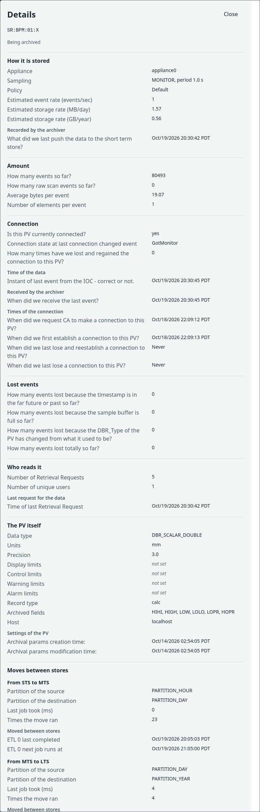

# Management interface

The management web interface of the appliance: the pages, what each
judgement shows and where its value comes from, the limits it keeps, and
how its files reach the WARs and take the site skin. The pages call the
server through the business process layer (BPL) actions that
[Scripting](scripting.md) describes; they need no server change of their
own.

The pages use no jQuery, no framework and no build tool. Every full page
carries a content security policy, and the charts are drawn with D3.

## Pages

The addresses of the pages are relative to the base address of the
management web application, for example
`http://archiver.example.org:17665/mgmt/ui/index.html`
([Installation layout and settings](installing.md)). The data viewer is served by the retrieval
web application, at `http://archiver.example.org:17668/retrieval/ui/viewer/archViewer.html`.

| Page | Address | For | Content |
| :--- | :--- | :--- | :--- |
| Archive PVs | `archive.html` | Everyone | Add one PV or a list of names, follow each request to the state Being archived, cancel, pause, resume or stop from its row |
| Browse PVs | `index.html` | Everyone | Find PVs, list the selected ones with their value and last event, plot up to five of them, act on them |
| System: Overview | `system.html` | Everyone | Three verdict lines and one row per measure with its value, its status and a link to the detail; the **i** button of a measure opens its meaning |
| System: Operations | `operations.html` | The person who looks after the appliance | Samples, dropped samples, write path, stores and ETL, processes, configuration |
| System: Retrieval performance | `retrieval.html` | A person whose data requests are slow | What the server reports and a request measured in the browser |
| System: External servers | `external.html` | Administrators | The other EPICS Archiver Appliance installations whose data this appliance serves: add or remove one |
| Analyzer | `analyzer.html` | Everyone | The Analyzer menu entry; forwards to the data viewer of the retrieval web application |
| Help | `help.html` | Everyone | How to use each page (moving around, Archive PVs, Browse PVs, System, Analyzer), a link to the management API reference of the appliance and a link to this manual, which needs access to the internet |
| Data viewer | `/retrieval/ui/viewer/archViewer.html` | Everyone | Charts per unit for the PVs of the address |

The right end of the menu bar of every page holds the time zone of the
console: Browser (the default), UTC, Berkeley, Chicago, NYC, Seoul or
Berlin. Every chart (its axis labels, its tooltip and its range strip,
which names the zone), the Last event column of the PV table and the
times of the Details window are written in the chosen zone; the choice is
kept in the browser and passed to the analyzer in the address as `tz`.
The five cities follow their own daylight saving time at each instant.

The addresses `metrics.html`, `storage.html`, `appliance.html`,
`reports.html`, `pvdetails.html`, `integration.html` and `cacompare.html`
forward to the page that replaced them; `pvdetails.html?pv=<name>` opens that PV on the Browse PVs
page.

## Information cards

A page says only what changes how it reads; the explanation of an item is
in its information card, which the **i** button beside the item opens.
One card is open at a time; it closes with Esc, its Close button or a
click outside it, and it ends with a link into the Help page. Every card
has one form:

- The title is a question, for example *Samples lost: is data missing?*
- The first row, **In short**, answers it in one or two sentences.
- A card of a measure (a row of the Overview, a section of Operations or
  Retrieval performance, the State column of the PV table) continues with
  **What it shows**, **Normal**, **Attention**, **Problem** and **What to
  do**, in that order; a row that does not apply is left out.
- A card of a control (the search modes, the chart options, the time and
  value range, the statistics, the heap and floor, the largest users of
  storage, Archive PVs, the external servers) has one row for each item of
  the control, named as the control names it, and **What to do** last when
  there is a next step.
- A card has at most six rows, a sentence has fewer than 40 words, and a
  term is explained where it first appears in the card. The
  [Glossary](glossary.md) defines the same terms for the manual.
- A threshold or a limit is read from the constant that the page judges
  with (`THRESHOLDS` in `js/system/judge.js`, the limits of the page), so
  that a card never types a number twice. A card names no setting of a
  properties file; where a remedy is a setting, the card names the
  administrator, and the setting is in [Configuration](configuration.md).
- The word is *sample* on every page; where a field is named by the
  server (`eventsDropped`), the card says that the server calls a sample
  an event.

The cards are written in the script of their page as a title followed by
its rows; `scripts/ui-static-checks.bash` reads them and refuses a card
whose first row is not In short, a card with more than six rows, the
fixed rows out of order, a row after What to do, a sentence of 40 words or
more, a typed threshold and a properties setting.

## Archive PVs page

One input takes a PV name or a pasted list with one name per line. The
sampling is left to the policy of the site; a folded **Sampling** choice
sets the period, the method, a policy or a controlling PV for every name.
The method and the controlling PV take effect only together with a period, which replaces the choice of the policy; the method is then the one chosen, or Monitor.
On **Archive** the page first searches every valid name on the network
through `searchPV` (the management forwards the call to the engine of
the appliance, which opens a channel of its own for five seconds and
closes it), six names at a time, with the count of names searched shown
and the button disabled meanwhile; the names a server answered are sent
to `archivePV`, and a name no server answered is listed with the answer
of the search and **Archive anyway**, which sends it all the same.
Under **Requested in this visit** each name has the answer of the request
and its state, and the actions of that state; a request the appliance
held because no server answered its name reads **Held** with the reason
and offers **Resume** (`resumeArchiveRequest`) and **Cancel request**:

## Browse PVs page

The Browse PVs page, with five PVs in the table and two of them plotted:

| Part | Behavior |
| :--- | :--- |
| Find | Words in any order with case ignored, glob, or regular expression; the **i** button beside the three modes explains the modes, the Show list and the prefix buttons; the prefix buttons, at most 24, group the matches by the first two `:` segments, and one pressed shows the PVs of that prefix until it is pressed again, as its title says; the rows in view show the state of a PV that is not in the table (paused, not archived), read in one call for at most 60 rows; under the count, Selected only shows only the selected PVs in the list until it is pressed again, and Clear selection clears every selection |
| Show | A selection of the list by one of the server reports: disconnected now, paused, never connected, waiting for the first connection, recently added, recently changed, highest event rate, highest storage rate, most storage used, most connection drops, silent for the longest time, most events dropped for a wrong time stamp, by buffer overflow and by a type change |
| Chart | The PVs whose Plot box is on, at most 5, with one value axis for each unit and a legend. Above it are the range buttons and the Refresh control; the line above the chart holds the time window and the value ranges; Options, Enlarge chart and Open in the analyzer are on the row of the Inspect heading. The gestures and options are listed under [Chart controls](#chart-controls) |
| Table of PVs | One row per PV selected in the list, at most 100, under the chart; the columns are listed under [The table of PVs](#the-table-of-pvs) |
| Distribution, scatter and statistics | Below the table: the distribution of the PV in front, the scatter of two PVs of the same unit, and the Summary of the chart |

A PV name is a base name with an optional field (`X:Y` or `X:Y.RBV`); a
name with a field is a PV of its own and the Browse PVs page and the viewer
accept it. A chart line is the held value of a monitored PV: it continues
through a time without samples, so a PV that changes rarely is drawn as
one line. It stops at the last sample and starts again at the next one
only where the archiver recorded a lost connection or an engine start, so
a lost connection is never drawn as a held value. A range of up to 10
minutes on the Browse PVs page (11 minutes in the viewer) shows the stored
samples; a longer one shows means over equal intervals (`meanSample_N`),
and the chart says so. An interval of such a range in which the archiver
has no sample has no value, and the line is not extended through it. The
viewer's CSV download holds the values as drawn, with the column
`interval_seconds` (1 for a stored sample, N for a mean over N seconds).

The state of a PV and the actions in its row:

| State | Actions in the row |
| :--- | :--- |
| Being archived, Disconnected, Appliance Down | Pause; More, which holds Change sampling, Maintenance and Stop archiving; Details |
| Paused | Resume; More; Details |
| Initial sampling, Appliance assigned | Cancel request; Details |
| Held | Resume, which makes the engine search for the name again; Cancel request; Details |
| Not being archived | A link to the Archive PVs page with the name of the PV in its address |

Stop archiving pauses the PV first, because the archiver removes only a
paused PV, and says so before it acts. Change sampling applies at once to
a running PV. Maintenance opens a window with rename, change of type and
consolidation, explained in the card of its **i** button; each of them
pauses the PV first, and a change of type asks for a confirmation that a
backup exists. The More menu closes with
Esc and with a click outside it; each window closes with Esc, its Close
button and a click outside it, and the focus returns to the control that
opened it. Under the table, Pause all selected, Resume all selected and
Stop archiving all selected ask first and act on every PV of the table, and
Open all selected in the analyzer opens every PV of the table in the
analyzer over the window of the chart.

The state is kept in the fragment of the address, the part after `#`
(`index.html#q=bpm&range=10&pv=SR:BPM:01:X`), so a link reproduces the view:

| Parameter | Meaning |
| :--- | :--- |
| `q` | The search words |
| `mode` | `contains` (default), `glob` or `regex` |
| `report` | The selection of the Show list: `disconnected`, `paused`, `never`, `metagets`, `recent`, `modified`, `eventrate`, `storagerate`, `consumed`, `lost`, `silent`, `droppedtime`, `droppedbuffer` or `droppedtype`; none selects all archived PVs |
| `range` | The range in minutes (default 60) |
| `from`, `to` | A zoomed window, in milliseconds since the epoch |
| `pv` (repeated) | The PVs of the table |
| `plot` (repeated) | The PVs whose Plot box is on, at most 5, among the `pv` names |

## The table of PVs

Each PV selected in the list has one row. The **i** button beside the
count of the table explains the columns, and the one in the heading of the
State column says what a lost sample is and what to do about each cause:

| Column | Content |
| :--- | :--- |
| Plot | The box that draws the PV in the chart. It is off when the row appears. At most 5 boxes are on; at 5 the other boxes are disabled, and the pointer over one of them, or a tap on it, says why in its title and in a note beside the counters of the table. Beside the counter `table x/100`, First 5 turns on the boxes of the first five rows and turns off the others, Deselect all turns every box off, Plotted only shows only the rows whose box is on (the counter then reads the shown rows of the chosen PVs) until it is pressed again, and Clear selection unticks every PV so that the table is empty |
| PV | The name |
| Protocol | CA or PVA, read from `usePVAccess` of `getPVTypeInfo`; empty for a PV that is not archived |
| State | The state word of the PV and, when events were lost, `N lost`, where N is the sum of `eventsDropped` of the reports `getPVsByDroppedEventsTimestamp`, `getPVsByDroppedEventsBuffer` and `getPVsByDroppedEventsTypeChange`. The column is shown only while a PV is not in its normal state, which is Being archived with no lost event. A PV whose type changed reads Paused soon after, because the engine pauses it, and its Details window says why |
| Trend | A small line of the chosen range, for every PV of the table whether or not its Plot box is on; none for an array PV |
| Value | The value of the newest sample at or before the end of the chart window, with its unit, aligned on the decimal point. An array reads `array of N`. A PV with no sample in the 30 days before the end of the window has an empty cell with `no sample in 30 days` as its title |
| Last event | The date and time of that sample, which is the time of the data and not the time at which the archiver received it, written in the time zone chosen in the menu bar; the title holds the instant in UTC to the millisecond and the zone in which the cell is shown |
| Std dev | The standard deviation of the points of the Trend; shown only while the Standard deviation band of the chart options is on |
| Actions and Details | The buttons of the state of the PV, listed under [Browse PVs page](#browse-pvs-page) |

Value and Last event come from one call of `getDataAtTime` for all the PVs of the table. While the window ends now the page leaves the instant out and the server answers with the newest sample; for a window that ends earlier the page sends the end of the window. A window of 10 minutes or less shows the same sample as the last one that `getData` returns for it; a longer window draws a mean in its last interval, which is not a sample.

The **Details** button opens a window with the groups below. A value is read by the exact name of the call that holds it, `getPVStatus`, `getPVTypeInfo` or `getPVDetails`; a time of those calls also comes as epoch seconds (`epochSeconds` in an element of `getPVDetails`, `lastEventEpochSeconds` beside `lastEvent`), which a client uses to write it in another zone. A name that the call does not hold reads *not provided*. PVA units and connection endpoints are reported when available. A value that is present and empty, a pair of limits that are both NaN, and a limit that is NaN read *not set*; for a CA record without a unit the call returns an empty string, so its unit reads *not set*. A time that comes with its epoch seconds is written in the time zone chosen in the menu bar, and any other time as the server writes it, in the time zone of the server, under the heading of its kind: the time of the data, received, recorded, moved, and the times of the connection, of the settings of the PV and of the last request for its data.

Stored configuration rows, including SCAN, show `getPVTypeInfo` values. The separate latest received metadata group shows engine availability, enum choices, description, and alarm hysteresis. Valid zero limits, including a 0/0 pair, remain visible.

Availability follows the parent PV connection. Paused or disconnected channels do not supply current metadata; this differs from an empty value received from the IOC. Enum choices reads *empty list* when the IOC supplies an empty choice list, and *not provided* when choice metadata is unavailable.

Archived PVA channels also monitor the record `DESC` and `HYST` fields when available. Received field values take precedence over the corresponding main-PV metadata. If an individual field disconnects, the archiver uses the main-PV value when available. A reconnected field takes precedence again only after receiving a valid value. Servers without those field channels retain main-PV metadata.

Field changes remain pending until the archive buffer accepts a timestamped sample carrying them. With SCAN sampling, skipped samples retain their metadata changes for the next stored sample. Latest received metadata can therefore be newer than the last archived sample.

| Group | Content |
| :--- | :--- |
| How it is stored | The appliance, the sampling, the policy, the estimated event rate, storage rate and growth, and the time at which the archiver last passed the data to the short term store |
| Amount | The events so far, the raw scan events, the bytes per event and the elements per event |
| Connection | Whether the PV is connected, its connection state and the connection drops, with the time of the data of the last event, the time at which the archiver received the last event, and the times of the connection |
| Lost events | The events lost for a wrong time stamp, for a full sample buffer and for a change of type, and their sum |
| Who reads it | The number of retrieval requests and of users, and the time of the last request |
| The PV itself (stored configuration) | The data type, unit, precision, limits, record type, SCAN, archived fields and the host of the latest connection that updated the stored configuration, with the times at which its settings were created and last changed |
| Latest received metadata | Engine availability, enum choices, description and alarm hysteresis from the latest received metadata |
| Moves between stores | For each move, for example from the short term store to the medium term store, the granularity of the source and of the destination, the duration of the last job, the number of runs, and the times of the last and the next run |

A paused PV has no connection, no lost events and no moves between stores to report; its Details window says so for those groups.

## Refreshing the page

The control beside the range buttons offers Off, 10 s, 30 s and 1 min; 30 s is the default and the choice is kept in the browser. At each period the page reads Value and Last event again with one `getDataAtTime` call and the lost events from the three reports. The Trend and the chart are read again when their data is older than 25 seconds, so no more often than every 30 seconds. **Refresh now** reads everything once, and the time of the last read is written beside the control as Updated.

With Off nothing changes until Refresh now is pressed; the state of a PV is read again only after an action on it and while its request is unfinished. A window that ends earlier than now has nothing new to read, so the control is dim and nothing is refreshed. A hidden browser tab pauses the refresh and a visible one reads again at once.

## Chart controls

The chart of the Browse PVs page draws up to 5 PVs. Each unit has its own value axis, split between the left and the right side of the plot; PVs with no unit share one axis named no unit. The chart answers these controls:

| Control | Effect |
| :--- | :--- |
| The line above the chart | Always there, so that choosing a range moves nothing. It writes the time window as an interval on a 24 hour clock, `2026-10-15 [10:51:45, 11:01:45]`, with what both ends share written once before the brackets, and offers Earlier, Later and Back to the selected range as icons with a tooltip; Earlier and Later also work on the range of the buttons. Each value axis has a control that names its unit and shows the range chosen on it, and All resets the window and every range. A bracket includes the data at that end and a parenthesis leaves it out. A control with nothing to do is dim |
| Drag across the plot | Chooses a time window. After you release the button the page requests the data of the window once, one request for each PV. A double-click, or the button Back to the selected range, returns to the selected range |
| Drag along an axis | Chooses the value range of that unit and makes no request. The histogram and the table of the Projection tab count the samples inside it. Home, a double-click or the control of its unit in the line above the chart clears it |
| Arrow keys, `+` and `-` on a focused axis | Move, narrow and widen the value range of that unit; Home clears it. Tab moves the focus to the axes |
| Pointer over the plot | Shows a tooltip with the date and time and the value of each PV with its unit |
| Legend item | Hides or shows that line |
| Options, Projection tab | Shows a histogram of the samples at the right edge of the chart, with a line at the mean, and a table with the number of samples, the minimum, mean, median, maximum, and standard deviation of each PV. They count the samples inside the time window and inside a chosen value range. The Summary of the chart below the plots counts the whole time window and does not follow a value range |
| Options, Chart tab | Sets the Line (Step, Straight, Smooth, Points), the Y scale (Linear, Symmetric log, Log, Square root), the Marks (Auto marks the samples when 200 or fewer are in view, On marks every sample, Off hides them), the Window of 30 samples by default, the Running average, and the Standard deviation band. The running average and the band restart after a gap in the data. Log needs values above zero and Square root values not below zero; otherwise the chart shows Symmetric log and states the reason |
| Enlarge chart | Draws the chart again in a window as large as the browser window; Esc or Close returns |
| Open in the analyzer | Opens the PVs and the time window of the chart in the analyzer, in a new tab; the link is hidden until the chart has PVs |

The charts of the System pages Operations and Retrieval performance carry the same Options (the Projection and Chart tabs) and Enlarge chart as the chart of the Browse PVs page, and the same drawing controls on the plot. They have no Open in the analyzer link and no Earlier, Later or Back to the selected range, because the appliance keeps only the last 24 hours of its own measures in memory, one point a minute, and stores nothing older. The options chosen on a chart are kept while the page is open and stay after the page refreshes itself every 30 seconds; they are not kept when you leave the page.

## The list of PV names

Archived names do not leave the list when their IOC stops, so a change of
the list is almost always an addition. The page keeps a snapshot of the
names in the browser (IndexedDB database `aa-browse-names`), shows it at
once with the time it is current to, and then keeps it current:

| Event | What the page does |
| :--- | :--- |
| Every 15 s while the page is visible | Asks for the number of PVs; nothing else when it is unchanged |
| The number rose | Reads the most recently added PVs and merges them |
| The number was unchanged for four polls | Reads the 20 most recent additions too, because a removal and an addition within one poll leave the number as it was; a removed name stays in the list until the number falls or the snapshot is a day old |
| The number fell, the snapshot is a day old, or an addition may be incomplete | Reads the whole list again |
| A name the snapshot lacks is searched | Asks the server once and keeps what it knows |
| More than 500,000 names | Does not hold the list; the server answers each search |

## What the System pages judge

The Overview gives three verdicts and one row per measure, with its value,
its status, its Detail in words and a link to the page that shows the
measures behind it; the **i** button beside a measure opens its card. A
verdict line is Normal only when every measure it rests on is reported and
fine; a measure the appliance does not report makes the line Not reported
and names what is still unknown:

The Operations page gives the reading behind each verdict, in the sections
Samples, Samples lost, Writing to disk, Stores, Processes and Configuration
in effect. Each section answers the question under its heading; the **i**
button beside the heading opens its card, and a judged measure shows its
status word with the sentence that explains it. A measure row has a plain
name, its value with the unit, and a small **i** of its own whose card
holds the one sentence that says what the value is; the sentences come
from the code that computes the measure. The Counts table of Samples
counts the active PVs of the engine (the archived PVs that are not paused)
by connection, the paused PVs, the channels still searching for a server,
the requests being measured, and the sample and byte rates. Writing to
disk shows the share of the write period the last write took, computed
from the seconds of the last write and the write period the engine
reports, the rate the write moved against the rate at which samples
arrive, the headroom, the writes queued and the requests not yet archived.
Stores draws one bar per store with its percent on the bar and the used
and total GB and the copy time in columns, lists the moves between stores
with the rows of the last pass and the rows over time, and the rates
measured at the archive requests of this appliance with their change
since the capacity plan. Processes shows the heap now and the floor of
each process, the heap charts and the load of the host. Configuration in
effect lists the settings and the thresholds; the basis of the thresholds
is in its card. The Samples lost section lists the four reports of dropped
samples with the cause, the number of PVs, the worst PV, the sum and the
remedy of each: a wrong time stamp asks for the clock of the IOC; a buffer
overflow for a shorter sampling period, which rebuilds the buffer; a type
change, after which the engine pauses the PV, for the change of type in
the Maintenance window and a resume, or, from a number to a string or a
waveform, for a stop, a deletion of the data and a new archive request.
The Stores section ends with a treemap of the stored data or the event
rate by PV name prefix, so the prefixes that use the space show at once;
a prefix opens its PVs in the Browse PVs page. The next figure shows the first
sections:

The judgements are starting values, shown on the Operations page under
Configuration in effect. A measure that the appliance does not report is shown as Not
reported and is never shown as Normal.

| Judgement | Attention | Problem | Basis |
| :--- | :--- | :--- | :--- |
| Days left in the stores | Fewer than 30 days | Fewer than 7 days | Free space divided by the data the archiver adds per day |
| Free share of a device | Below 5 % | Below 3 % | Prometheus node exporter alert defaults |
| Write time of the engine | 50 % of the write period or more | 100 % or more | Samples are lost when the writer needs more than its period |
| Lowest heap after a collection | 70 % of the maximum, or a rise of 5 points in a day | 90 % | The live set of the application, not the instantaneous heap |
| A PV disconnected | For more than an hour | No PV connected | A shorter loss is often a restart |
| An ETL pass | Overran its interval, late, or a failed job | Busy for 200 % of its interval | The measures the ETL reports |
| Dropped samples | None | Any PV in the four dropped-event reports | A dropped sample is lost data |
| Components | Different versions | A component is not running | The appliance status and version reports |

The cards name no setting; where a remedy is one, they name the
administrator. The seconds of write delay a sample buffer absorbs are
`org.epics.archiverappliance.config.PVTypeInfo.sampleBufferMarginSeconds`
in `archappl.properties`, at least 1.0 ([Configuration](configuration.md)).
The heap size of a process is a setting of the installation that starts
the JVMs, not of the appliance.

Disconnected PVs are grouped by the endpoint reported by the CA or PVA
connection and the time they were lost. PVA endpoints may include a port.
The appliance reports no IOC name, and one host can serve several IOCs.
A missing endpoint is listed under an unknown host.

## Retrieval performance page

The page has two halves. **Measure from this browser** makes one ordinary
data request for a PV and a range of the last hour, day, week or 30 days
and shows the samples, the size and the time to the first byte and to the
end. **What the server says** shows the retrieval process, the requests
and users counted so far, the retrieval heap, the load average and
whether an ETL pass is running; the heap trend appears when the appliance
has two hours of values. **Data available for a PV** looks a PV up in the
stores. The **i** button beside each of the three headings and beside the
heap chart opens its card: when a request is slow, what to do and how much
data a range reads; what the server reports; which line of the heap chart
matters; and why a long range is slower.

## External servers

The tab lists the servers whose data this appliance serves, each with its
URL and its indexes. **Add a server…** takes the `data_retrieval_url` of
another EPICS Archiver Appliance installation and connects it; **Remove…**
stops serving one. The **i** button beside the heading explains the list,
and the one in each window says what the address is and what a removal
changes. The upload of Channel Archiver configuration files, the
comparison with a Channel Archiver and the Channel Archiver data server
type are not in the interface; their calls remain
([Scripting](scripting.md)).

## Limits and refresh

| Item | Value |
| :--- | :--- |
| PVs in the table | 100 |
| PVs in a chart | 5; each unit has its own value axis |
| Concurrent data requests | 6 |
| Status of the PVs of the table | Every 3 s while a request is unfinished or an action is recent, every 20 s otherwise; with the Refresh control on Off, only in the first two cases |
| Value, Last event and lost events of the table | At the period of the Refresh control (10 s, 30 s or 1 min); the Trend and the chart no more often than every 30 s |
| System: Overview, Operations, Retrieval performance | Every 20 s, 30 s and 30 s while the page is visible |
| A request measured on the Retrieval performance page | The whole answer is read into the page, about 100 bytes per sample (a week of a PV at 1 Hz is about 60 MB); the card of the Measure heading says so |

Measured on one host with 100 PVs at 1 Hz, ten minutes of samples each:
every scan row is filled in 0.65 s or less, and the slowest data request
takes under 50 ms.

## Browsers and security

| Item | Behavior |
| :--- | :--- |
| Supported | The current releases of Firefox, Edge and Safari; no jQuery, no framework and no build tool. Checked in Firefox, Edge and the WebKitGTK engine of Safari, not in the Safari application |
| Content security policy | `script-src 'self'` on every page: no inline script, event-handler attribute or style attribute, and no outside host |
| `connect-src` | `'self'`, and `http:` and `https:` on the Browse PVs page and the Retrieval performance page, which read the data retrieval address the appliance reports |
| Stored in the browser | The snapshot of the names (IndexedDB database `aa-browse-names`), the time zone of the console (`aa.timeZone`) and the period of the Refresh control (`aa.browse.refresh`), both in local storage; nothing else |
| Data inserted into a page | Only as text, never as markup |

## Files and site skin

The files live under `src/main/org/epics/archiverappliance/` and the
build copies each `staticcontent` folder whole into its WAR:

| Folder | Served as | Content |
| :--- | :--- | :--- |
| `mgmt/staticcontent/` | `/mgmt/ui/` | The pages, `css/` and `js/` of the management interface |
| `retrieval/staticcontent/viewer/` | `/retrieval/ui/viewer/` | The data viewer |
| `staticcontent/` | `ui/comm/` of every WAR | `css/main.css` (the site skin), `css/chart.css`, `img/` (the header and site logos), `js/aa/` (the shared chart code) and `js/vendor/` (D3) |

The chart library is D3 7.9.0 (ISC): `js/vendor/d3.min.js` is
`dist/d3.min.js` of the npm tarball `d3-7.9.0.tgz`, `d3.SOURCE.txt` beside
it records the tarball integrity and the SHA-256 of the file, and
`d3.LICENSE.txt` holds the license. `js/aa/chart.js` is shared by the
management pages and the viewer; a change to it changes both.

The pages take their colors, fonts and spacing from the tokens of
`css/main.css`. A site supplies its own `css/main.css` through the site
folder that [Building](building.md#building-for-a-site) describes. That
file replaces the whole default stylesheet, so it defines every token of
the table; a token it leaves out is undefined on the pages that use it.
Several tokens are defined from others in the default file, such as
`--bg: var(--c-bg)`:

| Token | Use |
| :--- | :--- |
| `--c-brand`, `--c-accent`, `--c-accent-dark`, `--c-accent-soft` | The site header, links, buttons and selection |
| `--accent`, `--accent-ink`, `--focus-bg` | The accent of the page stylesheets, the text on an accent background, and the selected row |
| `--c-bg`, `--c-surface`, `--c-border`, `--c-border-strong` | Page, panel and rule colors |
| `--bg`, `--rule`, `--grid` | The page background, rules and chart grid lines of the page stylesheets |
| `--c-text`, `--c-muted`, `--ink`, `--ink-2`, `--ink-3` | Text |
| `--c-danger`, `--alarm`, `--warn` | The alert color, which `--alarm` also uses for error text and destructive buttons, and the attention color (`--warn`) |
| `--font-sans`, `--font-mono`, `--sans`, `--mono` | Fonts |
| `--radius`, `--shadow-sm`, `--shadow-md` | Corner radius and shadows |

The `main.css` of this repository also defines `--c-danger-soft`,
`--c-stripe` and `--c-hover`, which no stylesheet uses. The CI contrast
check reads `--ink`, `--ink-2`, `--ink-3`, `--accent`, `--warn` and
`--alarm` against `--bg` and `--focus-bg` in the default `main.css` and
requires at least 4.5 to 1. A site file keeps the same contrast; the
check does not read it.

The build replaces the marker blocks `site_header`, `site_logo`,
`site_navbar` and `site_footer` of every management page that carries
them with those of `index.html`; the forwarding pages carry none. A
site's `template_changes.html` replaces them in turn, so every other
management page keeps the four blocks.

## Checks

Three checks guard the interface files:

- `StaticContentBPLCallsTest` reads every `../bpl/<name>` call of the
  management files and checks each name against the registered BPL
  actions, so a call must be written with its literal path.
- `SiteOverlayTest` applies a site folder to the pages and checks the
  result.
- `scripts/ui-static-checks.bash` runs in the CI before the Maven build.
  It checks the marker blocks, the content security policy, the absence
  of inline code, outside hosts, jQuery and text turned into markup, that
  the files a page names exist, that every element id a script reads
  exists in its page, that `d3.min.js` is the file whose SHA-256
  `d3.SOURCE.txt` records, the PV name pattern, the contrast of the text
  colors, and the form of the [information cards](#information-cards);
  twenty-three broken copies of the tree must each be refused for their
  own reason. Run it locally with `bash scripts/ui-static-checks.bash`; it
  needs `python3` and `sha256sum`.
