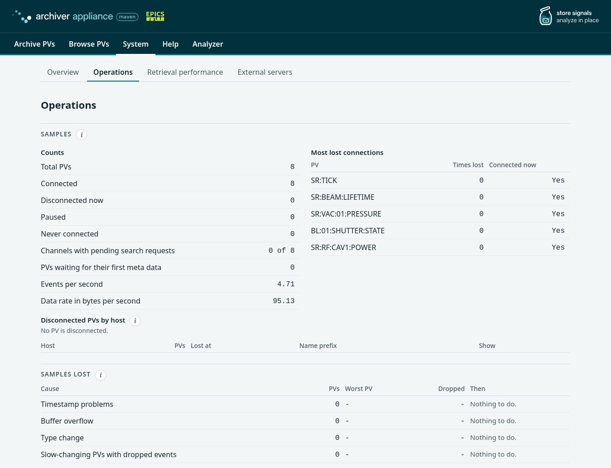
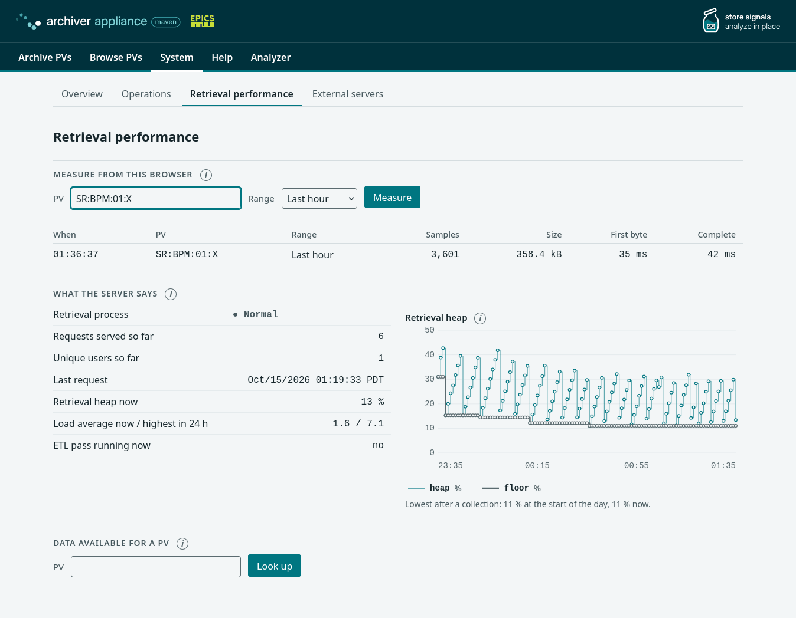

# Management interface

The management web interface of the appliance: the pages, what each
judgement shows and where its value comes from, the limits it keeps, and
how its files reach the WARs and take the site skin. The pages call the
server through the BPL actions that the [Developer guide](developer.md)
documents; they need no server change of their own.

The pages use no jQuery, no framework and no build tool. Every full page
carries a content security policy, and the charts are drawn with D3.

## Pages

| Page | Address | For | Content |
| :--- | :--- | :--- | :--- |
| Work | `index.html` | Everyone | Find PVs, scan the selected ones, inspect them, act on them |
| System: Overview | `system.html` | Everyone | Three verdict lines and one row per measure with its value, its status and a link to the detail; the **i** button of a measure opens its meaning |
| System: Operations | `operations.html` | The person who looks after the appliance | Samples, dropped samples, write path, stores and ETL, processes, configuration |
| System: Retrieval performance | `retrieval.html` | A person whose data requests are slow | What the server reports and a request measured in the browser |
| System: External servers | `external.html` | Administrators | The other EPICS Archiver Appliance clusters whose data this appliance serves: add or remove one |
| Analyzer | `analyzer.html` | Everyone | The Analyzer menu entry; forwards to the data viewer of the retrieval web application |
| Help | `help.html` | Everyone | How to use each page, the PV states, the API reference and a link to this manual; it needs no network beyond the appliance |
| Data viewer | `/retrieval/ui/viewer/archViewer.html` | Everyone | Charts per unit for the PVs of the address |

The addresses `metrics.html`, `storage.html`, `appliance.html`,
`reports.html`, `pvdetails.html`, `integration.html` and `cacompare.html`
forward to the page that replaced them; `pvdetails.html?pv=<name>` opens that PV on the Work
page.

## Work page

The Work page, with three PVs selected:

| Part | Behavior |
| :--- | :--- |
| Find | Words in any order with case ignored, glob, or regular expression; chips group the matches by the first two `:` segments; the rows in view show the state of a PV that is not in the scan list (paused, not archived), read in one call for at most 60 rows |
| Show | A selection of the list by one of the server reports: disconnected now, paused, never connected, waiting for the first connection, recently added, recently changed, highest event rate, highest storage rate, most storage used, most connection drops, silent for the longest time, most events dropped for a wrong time stamp, by buffer overflow and by a type change |
| Scan | One row per selected PV with its state, a trend of the chosen range, the value now and the last event; at most 100 PVs. A link opens the selected PVs in the data viewer over the window of the chart |
| Inspect | Time series of at most 5 PVs of the same unit, distribution, scatter and statistics; a drag across the chart zooms to that window and marks the samples when 200 or fewer are in view; Earlier and Later move the window by half its span |
| Detail | State with its explanation, the actions that apply, a link that opens the PV in the data viewer, and the full details list |

A PV name is a base name with an optional field (`X:Y` or `X:Y.RBV`); a
name with a field is a PV of its own and the Work page and the viewer
accept it. A chart line is the held value of a monitored PV: it continues
through a time without samples, so a PV that changes rarely is drawn as
one line. It stops at the last sample and starts again at the next one
only where the archiver recorded a lost connection or an engine start, so
a lost connection is never drawn as a held value. A range of up to 10
minutes on the Work page (11 minutes in the viewer) shows the stored
samples; a longer one shows means over equal intervals (`meanSample_N`),
and the chart says so. An interval of such a range in which the archiver
has no sample has no value, and the line is not extended through it. The
viewer's CSV download holds the values as drawn, with the column
`interval_seconds` (1 for a stored sample, N for a mean over N seconds).

The state of a PV and the actions that apply:

| State | Actions |
| :--- | :--- |
| Being archived | Pause, Change sampling, Stop archiving, Maintenance |
| Paused | Resume, Change sampling, Stop archiving, Maintenance |
| Initial sampling, Appliance assigned | Abort the request |
| Not being archived | Archive |

Stop archiving pauses the PV first, because the archiver removes only a
paused PV. Change sampling applies at once to a running PV. Maintenance
holds rename, change of type and consolidation; each of them pauses the PV
first, and a change of type asks for a confirmation that a backup exists.
Pause, Resume and Stop archiving also work on all selected PVs at once.

The state is kept in the fragment of the address, the part after `#`
(`index.html#q=bpm&range=10&pv=SR:BPM:01:X`), so a link reproduces the view:

| Parameter | Meaning |
| :--- | :--- |
| `q` | The search words |
| `mode` | `contains` (default), `glob` or `regex` |
| `report` | The selection of the Show list: `disconnected`, `paused`, `never`, `metagets`, `recent`, `modified`, `eventrate`, `storagerate`, `consumed`, `lost`, `silent`, `droppedtime`, `droppedbuffer` or `droppedtype`; none selects all archived PVs |
| `range` | The range in minutes (default 60) |
| `from`, `to` | A zoomed window, in milliseconds since the epoch |
| `pv` (repeated) | The selected PVs |

## The list of PV names

Archived names do not leave the list when their IOC stops, so a change of
the list is almost always an addition. The page keeps a snapshot of the
names in the browser (IndexedDB database `aa-work-names`), shows it at
once with the time it is current to, and then keeps it current:

| Event | What the page does |
| :--- | :--- |
| Every 15 s while the page is visible | Asks for the number of PVs; nothing else when it is unchanged |
| The number rose | Reads the most recently added PVs and merges them |
| The number was unchanged for four polls | Reads the 20 most recent additions too, because a removal and an addition within one poll leave the number as it was; a removed name stays in the list until the number falls or the snapshot is a day old |
| The number fell, the snapshot is a day old, or an addition may be incomplete | Reads the whole list again |
| A name the snapshot lacks is searched | Asks the server once and keeps what it knows |
| More than 500,000 names | Does not hold the list; the server answers each search |

## What the System pages judge

The Overview gives three verdicts and one row per measure, with its value,
its status and a link to the detail; the **i** button beside a measure opens
a card with its meaning:

The Operations page gives the reading behind each verdict, in the sections
Samples, Samples lost, Write path, Stores, Processes and Configuration in
effect. The **i** button beside a section heading opens a card with
when the section needs attention, when it is a problem and what to do;
the next figure shows its first sections:

The judgements are starting values, shown on the Operations page next to
their basis. A measure that the appliance does not report is shown as Not
reported and is never shown as Normal.

| Judgement | Attention | Problem | Basis |
| :--- | :--- | :--- | :--- |
| Days left in the stores | Fewer than 30 days | Fewer than 7 days | Free space divided by the data the archiver adds per day |
| Free share of a device | Below 5 % | Below 3 % | Prometheus node exporter alert defaults |
| Write time of the engine | Above 50 % of the write period | 100 % or more | Samples are lost when the writer needs more than its period |
| Lowest heap after a collection | 70 % of the maximum, or a rise of 5 points in a day | 90 % | The live set of the application, not the instantaneous heap |
| A PV disconnected | For more than an hour | No PV connected | A shorter loss is often a restart |
| An ETL pass | Overran its interval, late, or a failed job | Busy for 200 % of its interval | The measures the ETL reports |
| Dropped samples | None | Any PV in the four dropped-event reports | A dropped sample is lost data |
| Components | Different versions | A component is not running | The appliance status and version reports |

The remedies in those cards name the setting to change. The
seconds of write delay a sample buffer absorbs are
`org.epics.archiverappliance.config.PVTypeInfo.sampleBufferMarginSeconds`
in `archappl.properties`, at least 1.0 ([Configuration](configuration.md)).
The heap size of a process is a setting of the installation that starts
the JVMs, not of the appliance.

Disconnected PVs are grouped by the host the Channel Access connection
came from and the time they were lost, because the appliance reports no
IOC name. A PV Access PV has no host and is listed under an unknown host.

## Retrieval performance page

The page has two halves. **Measure from this browser** makes one ordinary
data request for a PV and a range of the last hour, day, week or 30 days
and shows the samples, the size and the time to the first byte and to the
end. **What the server says** shows the retrieval process, the requests
and users counted so far, the retrieval heap, the load average and
whether an ETL pass is running; the heap trend appears when the appliance
has two hours of values. **Data available for a PV** looks a PV up in the
stores.

## External servers

The tab lists the servers whose data this appliance serves, each with its
URL and its indexes. **Add a server…** takes the `data_retrieval_url` of
another EPICS Archiver Appliance cluster and connects it; **Remove…**
stops serving one. The upload of Channel Archiver configuration files, the
comparison with a Channel Archiver and the Channel Archiver data server
type are not in the interface; their calls remain
([Scripting](scripting.md)).

## Limits and refresh

| Item | Value |
| :--- | :--- |
| PVs in the scan list | 100 |
| PVs in a chart | 5, and at most one unit per chart |
| Concurrent data requests | 6 |
| Status of the selected PVs | Every 3 s while a request is unfinished or an action is recent, every 20 s otherwise |
| System: Overview, Operations, Retrieval performance | Every 20 s, 30 s and 30 s while the page is visible |
| A request measured on the Retrieval performance page | The whole answer is read into the page, about 100 bytes per sample (a week of a PV at 1 Hz is about 60 MB); the page says so next to the form |

Measured on one host with 100 PVs at 1 Hz, ten minutes of samples each:
every scan row is filled in 0.65 s or less, and the slowest data request
takes under 50 ms.

## Browsers and security

| Item | Behavior |
| :--- | :--- |
| Supported | The current releases of Firefox, Edge and Safari; no jQuery, no framework and no build tool. Checked in Firefox, Edge and the WebKitGTK engine of Safari, not in the Safari application |
| Content security policy | `script-src 'self'` on every page: no inline script, event-handler attribute or style attribute, and no outside host |
| `connect-src` | `'self'`, and `http:` and `https:` on the Work page and the Retrieval performance page, which read the data retrieval address the appliance reports |
| Stored in the browser | The snapshot of the names; nothing else |
| Data inserted into a page | Only as text, never as markup |

## Files and site skin

The files live under `src/main/org/epics/archiverappliance/` and the
build copies each `staticcontent` folder whole into its WAR:

| Folder | Served as | Content |
| :--- | :--- | :--- |
| `mgmt/staticcontent/` | `/mgmt/ui/` | The pages, `css/` and `js/` of the management interface |
| `retrieval/staticcontent/viewer/` | `/retrieval/ui/viewer/` | The data viewer |
| `staticcontent/` | `ui/comm/` of every WAR | `css/main.css` (the site skin), `css/chart.css`, `js/aa/` (the shared chart code) and `js/vendor/` (D3) |

The chart library is D3 7.9.0 (ISC): `js/vendor/d3.min.js` is
`dist/d3.min.js` of the npm tarball `d3-7.9.0.tgz`, `d3.SOURCE.txt` beside
it records the tarball integrity and the SHA-256 of the file, and
`d3.LICENSE.txt` holds the license. `js/aa/chart.js` is shared by the
management pages and the viewer; a change to it changes both.

The pages take their colors, fonts and spacing from the tokens of
`css/main.css`, so a site changes the look by supplying its own
`css/main.css` with the same tokens, through the site folder that
[Building](building.md#building-for-a-site) describes:

| Token | Use |
| :--- | :--- |
| `--c-brand`, `--c-accent`, `--c-accent-dark`, `--c-accent-soft` | The site header, links and selection |
| `--c-bg`, `--c-surface`, `--c-border`, `--c-border-strong` | Page and rule colors |
| `--c-text`, `--ink-2`, `--ink-3` | Text, which keeps a contrast of at least 4.5 to 1 on the page |
| `--c-danger`, `--alarm`, `--warn` | The alert color and the attention color, used only for judgements and disconnections |
| `--font-sans`, `--font-mono` | Fonts |

The build replaces the marker blocks `site_header`, `site_logo`,
`site_navbar` and `site_footer` of every management page with those of
`index.html`, and a site's `template_changes.html` replaces them in turn,
so every page keeps the four blocks.

## Checks

Three checks guard the interface files:

- `StaticContentBPLCallsTest` reads every `../bpl/<name>` call of the
  management files and checks each name against the registered BPL
  actions, so a call must be written with its literal path.
- `SiteOverlayTest` applies a site folder to the pages and checks the
  result.
- `scripts/ui-static-checks.bash` runs in the CI before the Maven build.
  It checks the marker blocks, the content security policy, the absence
  of inline code, outside hosts, jQuery and text turned into markup, that
  the files a page names exist, that every element id a script reads
  exists in its page, that `d3.min.js` is the file whose SHA-256
  `d3.SOURCE.txt` records, the PV name pattern, and the contrast of the
  text colors; fifteen broken copies of the tree must each be refused for
  their own reason. Run it locally with `bash scripts/ui-static-checks.bash`.
