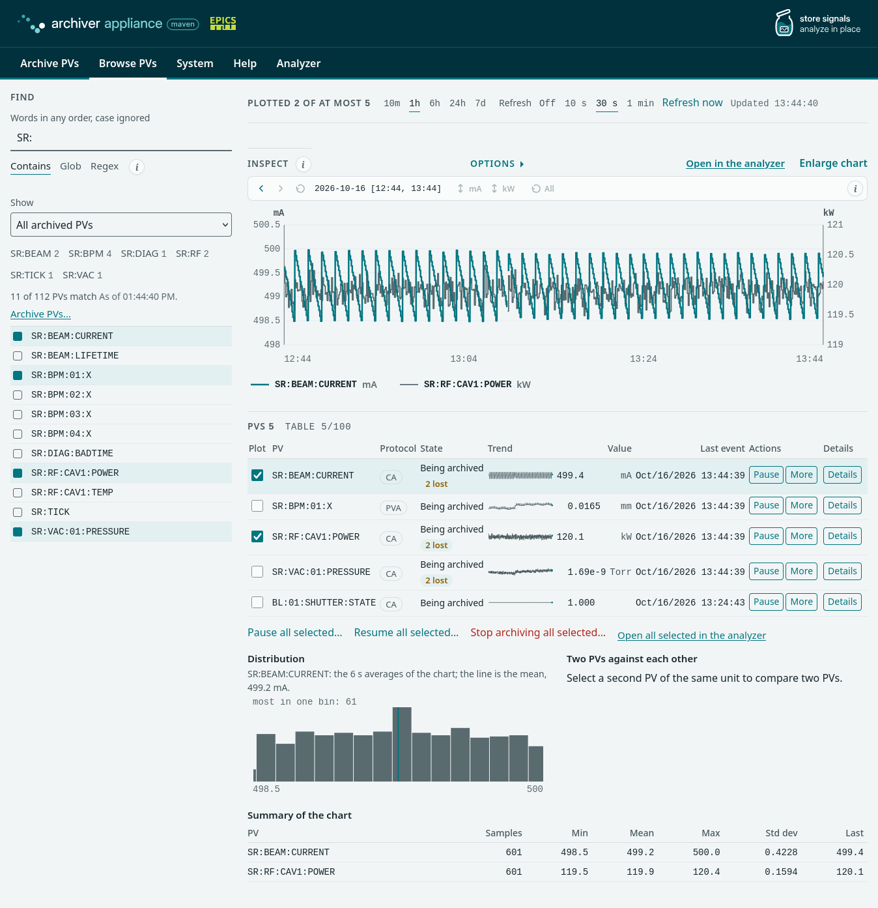
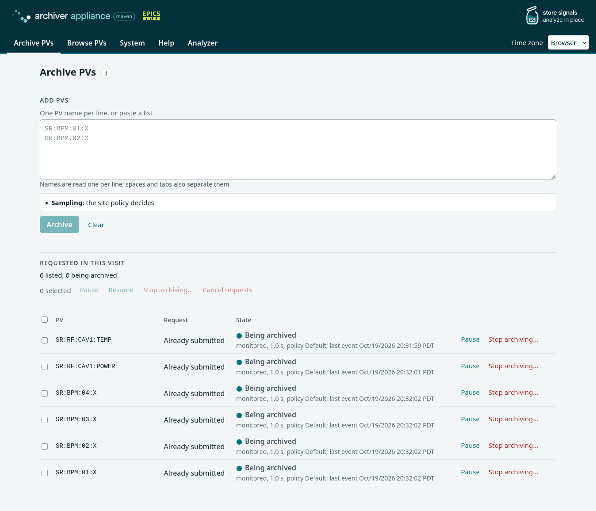
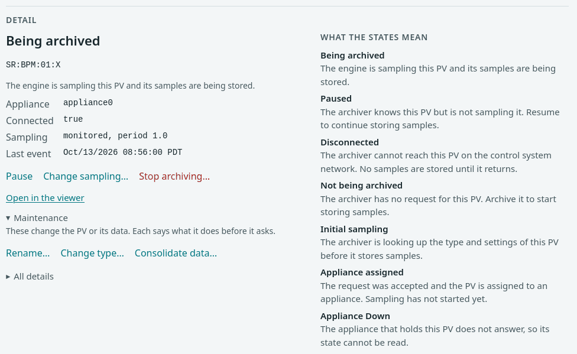
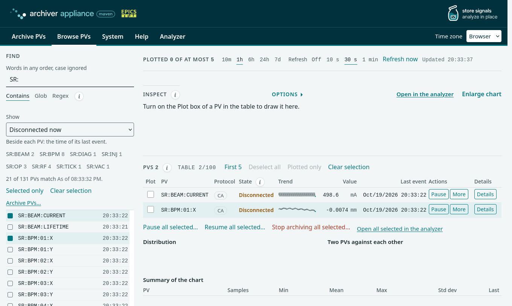
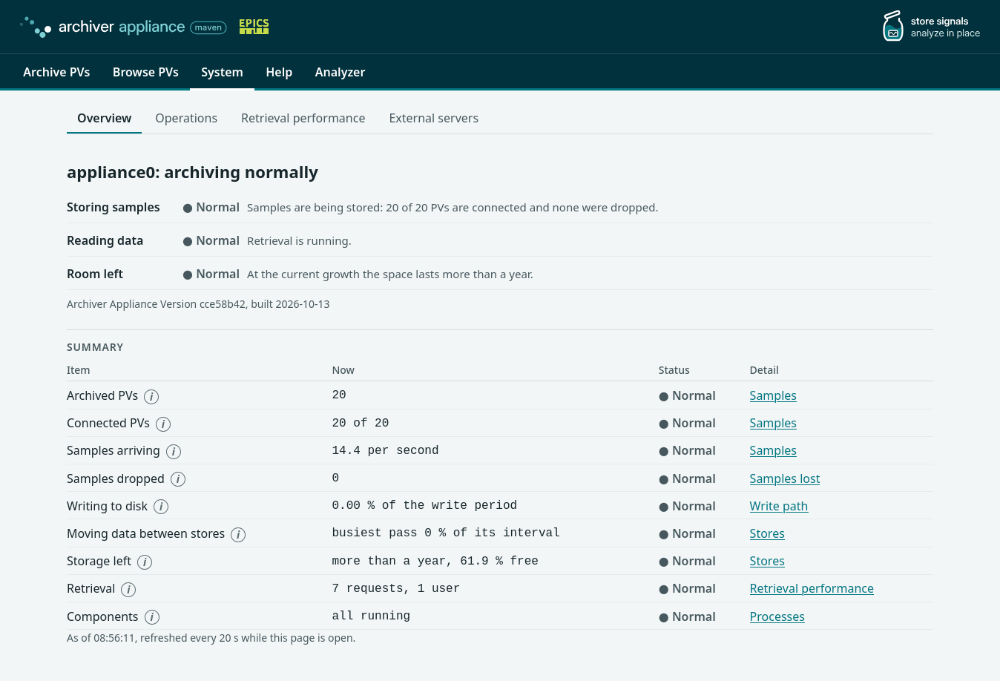

# Operating

## Scope

This page covers daily operation: adding and managing PVs in the web
interface, the PV states, the reports and the System pages, monitoring,
aliases, named flags, backup and recovery, and inspecting the CA and PVA
traffic.

**Out of scope:** each page of the web interface with its limits and its
site skin ([Management interface](interface.md)), the same operations
from scripts ([Scripting](scripting.md)) and the logs
([Logging](logging.md)).

## The web interface

The web interface is served by the mgmt web application at
`http://<host>:17665/mgmt/ui/index.html`. Every page carries one menu
bar, named by task; the entry of the page in view is marked:

| Menu entry | Opens | Purpose |
| --- | --- | --- |
| Archive PVs | the Archive PVs page | archive a PV and pause, resume or stop it |
| Browse PVs | the Browse PVs page | find PVs, list them with their value and last event, plot them, act on them; the reports are the **Show** list of the Find panel |
| System | System: Overview | status monitoring: the verdict on the appliance, then Operations and Retrieval performance |
| Help | the help page | how to use each page, the management API reference ([Scripting](scripting.md)) and a link to this manual, which needs access to the internet |
| Analyzer | the data viewer | the data viewer of the retrieval web application ([Retrieving data](retrieval.md#the-data-viewer)) |

On a screen 720 px wide or narrower the entries fold behind a **Menu**
button and open as one column. The **External servers** tab of System
lists the other archiver installations this appliance serves data for. The
addresses of the earlier pages (`reports.html`, `metrics.html`,
`storage.html`, `appliance.html`, `integration.html`) forward to their
place.

The Browse PVs page is the page of daily use. The next figure shows it with
five PVs in the table and two of them plotted: the Find panel on the left,
the chart, and the table with the protocol, the trend, the value and the
time of the last event of each PV, and the buttons of its state.



Turn on the **Plot** box of a row to draw that PV in the chart; at most five
PVs are drawn at a time. The controls of the chart (the time window, the
value range of each unit, the Options panel, Enlarge chart) are listed in
[Chart controls](interface.md#chart-controls), the columns of the table and
the **Refresh** control in [The table of PVs](interface.md#the-table-of-pvs)
and [Refreshing the page](interface.md#refreshing-the-page). The link **Open
in the analyzer** above the chart opens the plotted PVs in the data viewer,
which shows PVs as charts per unit, over the window of the chart
([Retrieving data](retrieval.md#the-data-viewer)); **Open all selected in the
analyzer** under the table opens every PV of the table.

## Adding PVs

1. Open **Archive PVs**. Type one PV name, or paste a list with one
   name per line, into **Add PVs**. A name is a base name with an
   optional field, such as `SR:BPM:01:X` or `SR:BPM:01:X.RBV`. A name
   that starts with `pva://` is archived over PVAccess. The note under
   the box counts the names and shows any that are not valid PV names.
2. Leave **Sampling** as it is, and the policy of the site chooses the
   method and the period of each PV. To choose them, open **Sampling**
   and set **Monitor** (store each change) or **Scan** (store at a fixed
   period), the period in seconds, a policy by name, or a controlling
   PV. The choice applies to every name.
3. Select **Archive**. The page first searches every name on the
   network through the engine (five seconds for each, a few at a time,
   and the count of names searched is shown meanwhile). A name a server
   answers is archived; a name no server answers is listed with **No
   server answered in 5 s** and **Archive anyway**, which files the
   request all the same, for an IOC that is not up yet.



Under **Requested in this visit** each name has the answer of the
request (**Archive request submitted**, or **Already submitted** when
the PV is archived or its request is pending) and its state, which the
page reads from the appliance every 2 s while a request is unfinished
and every 10 s otherwise. Once sampling has started the row shows how
the PV is sampled and which policy chose it. A list of more than a few
tens of names is sent to the `archivePV` call ([Scripting](scripting.md)).

The appliance looks up the type and settings of the new PV, applies the
policy, and starts archiving it. A request whose name no server answers
within the hold time of the appliance (ten minutes by default,
`holdArchiveRequestInMins` in [Configuration](configuration.md#archapplproperties))
is held: the engine stops searching, the row reads **Held** with the
reason, and **Resume** in the row searches again (when the IOC is up),
or **Cancel request** ends it. A held request is not aborted by the
abort time of the workflow; after a restart of the management it is
restarted from persistence and held again when the hold time passes. **Pause**,
**Resume** and **Stop archiving…** of a row act on that PV. Select rows
to act on several; **Cancel requests** acts on the ones that are
waiting, and a stop of a request that has not started cancels it
instead.

| State | Meaning |
| --- | --- |
| Initial sampling | the archiver looks up the type and settings of the PV before it stores samples |
| Held | no server answered the name within the hold time; the engine stopped searching and the request waits for Resume or Cancel request |
| Appliance assigned | the request is accepted and the PV is assigned to an appliance; sampling has not started |
| Being archived | the engine samples the PV and stores its samples |
| Paused | the archiver knows the PV but does not sample it; the engine pauses a PV by itself when its record comes back under the same name with another type, and the Details window then says why |
| Disconnected | the archiver cannot reach the PV on the control system network; no samples are stored until it returns |
| Not being archived | the archiver has no request for the PV |
| Appliance Down | the appliance that holds the PV does not answer, so its state cannot be read |

A PV that never connects is held after the hold time. Its row offers
**Resume** and **Cancel request**.

## Managing a PV

Use the buttons in the row of the PV in the table of the Browse PVs page.
Only the actions that fit its state appear. **More** holds Change sampling,
Maintenance and Stop archiving; **Maintenance** opens a window that
explains rename, change of type and consolidation before it asks.



| Action | Condition | Effect |
| --- | --- | --- |
| Pause, Resume | the PV is archived | stops or restarts sampling; the configuration and the stored data stay |
| Change sampling | the PV is archived or paused | sets the method and the period; a running PV takes them at once and the stored data does not change |
| Stop archiving | the PV is archived or paused | pauses the PV, removes it from the archiver and, when ticked, deletes its stored data |
| Cancel request | the PV is in Initial sampling or Appliance assigned | cancels the archive request |
| Rename | none; the PV is paused first | copies the settings and the data to the new name; both names stay paused until you resume the new one, once its data is checked, and stop the old one |
| Change type | none; the PV is paused first | converts the stored data of every store to the new type, in place; it asks for the confirmation that a backup exists; the PV stays paused, and a refusal shows its reason in the window |
| Consolidate data | none; the PV is paused first | moves the data of the earlier stores up to the chosen store |

**Pause all selected**, **Resume all selected** and **Stop archiving all
selected** under the table apply an action to every PV of the table and ask
first. **Details** in a row shows in groups what the archiver reports about
the PV.

## Reports and System pages

The **Show** list of the Find panel selects the PVs of one report. The
reports are:

- PVs that may not exist (never connected) and PVs waiting for their
  first connection;
- PVs that are disconnected now and the PVs with the most connection
  drops or the longest silence;
- paused PVs;
- the PVs with the highest event rate and the highest storage rate, and
  the PVs that use the most storage;
- recently added and recently changed PVs;
- PVs that dropped events because of a wrong time stamp, a buffer
  overflow or a type change. The engine log also holds one WARN line
  per write period for a PV whose buffer is full and one line for a PV
  whose type changed, which the engine then pauses. A buffer fills when
  the record posts faster than the sampling period of the request, because
  the buffer holds the samples of one write period at that rate; Change
  sampling with a shorter period rebuilds the channel with a larger
  buffer.



The System pages answer the questions of the person who looks after the
appliance. **Overview** gives three verdicts, storing samples, reading
data and room left, and one row per measure with its value, its status
and a link to the detail. The **i** button beside a measure opens a card
with what the measure means and where to act.



**Operations** shows the samples, the dropped samples, the write path,
the stores and ETL, the processes and the configuration in effect; the
**i** button beside each section says what it shows, when it needs
attention or is a problem, and what to do. **Retrieval performance**
measures a data request from the browser and shows what the server
reports. Every card has the form that [Information
cards](interface.md#information-cards) describes.
[Management interface](interface.md#what-the-system-pages-judge)
lists the judgements and their starting values.

When a store runs full, ETL follows the `OutOfSpaceHandling` key
([Configuration](configuration.md#archapplproperties)).

## Monitoring

- **Logs:** watch for ERROR and FATAL lines with `journalctl -p err`
  ([Logging](logging.md)). An error in the engine or ETL needs attention;
  one in retrieval or mgmt may come from a bad request. Search for
  `OutOfMemoryError` with no priority filter, because a line without a
  priority prefix arrives at priority 6 ([Known
  limits](logging.md#known-limits)) and `-p err` misses it:
  `journalctl -u epicsarchiverap-maven.service | grep OutOfMemoryError`.
- **Free space** of each store, from **Stores** on the System Operations
  page or the host.
- **Disconnected PVs**, from the **Disconnected now** selection of the
  Show list or the `getCurrentlyDisconnectedPVs` call. Pausing PVs that
  stay disconnected, and resuming paused PVs that are alive again,
  keeps this list short.
- **Dropped samples**, from the Samples lost section of the System
  Operations page or the three selections of the Show list that name
  dropped events. The Overview shows a Problem verdict while any PV
  dropped a sample.
- **Type changes:** when a PV changes its data type, the appliance stops
  archiving its new samples; the **Most events dropped by a type change**
  selection lists them. Either rename the paused PV and archive it again
  under its name, which keeps the old data under the new name, or
  convert its archived data with **Change type** on the paused PV, which
  rewrites the data (back it up first). The window reports `<PV> is stored
  as <type>` when the call succeeds. Before you resume the PV, check the
  **Data type** in **Details** and read back a sample of the stored data;
  if the data did not change, rename the PV and archive it again.

## Aliases

When a PV is added under an alias, the appliance reads the PV's `NAME`
field, archives it under the real name, and records the alias in the
`PVAliases` table. Retrieval and the management calls then work under
both names; the Browse PVs page lists the real name.

## Named flags

Named flags are appliance-wide boolean values, all false at startup.
They are set with the `setNamedFlag` call ([Scripting](scripting.md)) or
loaded at startup from a properties file named by the
`org.epics.archiverappliance.config.NamedFlags.readFromFile` key.

- `SKIP_<store>_FOR_RETRIEVAL`, for example `SKIP_LTS_FOR_RETRIEVAL`,
  leaves that store out of retrieval, for example while the LTS storage
  is unavailable.
- A store URL can name a flag in `etlIntoStoreIf` or `etlOutofStoreIf`
  ([Configuration](configuration.md#stores)).

## Backup

- **The configuration database** holds the archiving configuration of
  every PV ([Persistence](persistence.md#what-the-database-holds)). For
  MariaDB, dump the database that
  [Setting up MariaDB](persistence.md#setting-up-mariadb) creates:

  ```bash
  mysqldump -u archappl -p archappl > archappl.sql
  ```

  For SQLite, stop the appliance and copy the database file of the
  DataSource URL ([Setting up SQLite](persistence.md#setting-up-sqlite)),
  `archappl.sqlite` in that example, with `archappl.sqlite-wal` and
  `archappl.sqlite-shm` when they exist.
- **The configuration files** are `appliances.xml`
  ([Installing](installing.md#appliancesxml)), `policies.py` and
  `archappl.properties` ([Configuration](configuration.md)). Copy them
  with the other backups.
- **The stores** hold the samples as ordinary files, one per PV and
  partition, and can be backed up with file tools.
- The `exportConfig` call returns the `PVTypeInfo` records of the
  appliance as JSON, and `importConfig` loads such a file into an
  appliance that does not yet archive those PVs. Aliases and named
  flags are not part of the export.

## Recovering a lost appliance

Install a new host with the same identity in `appliances.xml`
([Installing](installing.md#appliancesxml)) and restore the configuration
files. Restore the configuration database from its backup: for MariaDB,
load the dump into the empty database that [Setting up
MariaDB](persistence.md#setting-up-mariadb) creates:

```bash
mysql -u archappl -p archappl < archappl.sql
```

For SQLite, put the copied file at the path of the DataSource URL. Restore
or remount the stores, and start the appliance; it archives the PVs of the
restored configuration. Giving the new host the IP address of the old one avoids
clients holding a cached address.

## Inspecting the CA and PVA traffic

A packet capture between the appliance and an IOC shows searches,
connections and subscriptions:

```bash
tcpdump -i <interface> 'host <ioc> and host <appliance>' -w capture.pcap
```

The filter keeps the packets between the two hosts. A search that the
appliance sends to a broadcast address, or to an address list that does
not name the IOC, is not between them and the filter misses it. To keep
the CA searches as well, add the UDP port of the IOC (`<ca_port>`, 5064 by
default):

```bash
tcpdump -i <interface> '(host <ioc> and host <appliance>) or udp port <ca_port>' -w capture.pcap
```

The [cashark](https://github.com/mdavidsaver/cashark/) plugin decodes CA
and PVA in Wireshark and `tshark`. The call `getPVDetails` of a PV lists the
CA channel ID, the server channel ID and the subscription ID of its channel,
and pausing and resuming the PV during the capture shows the channel's whole
life cycle.
