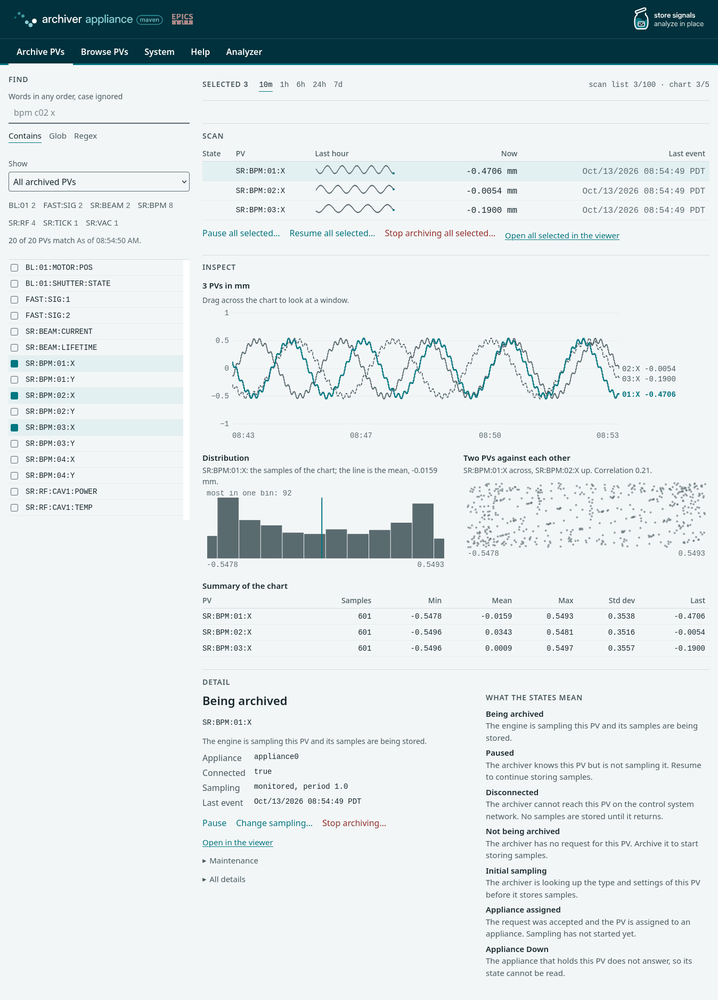
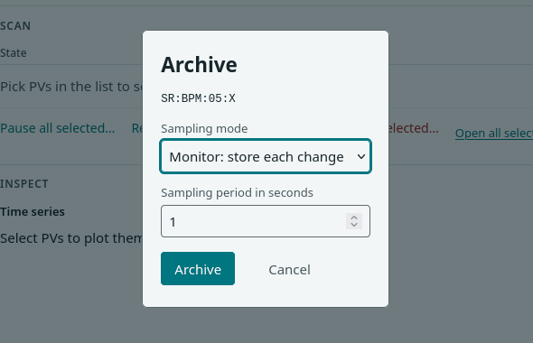
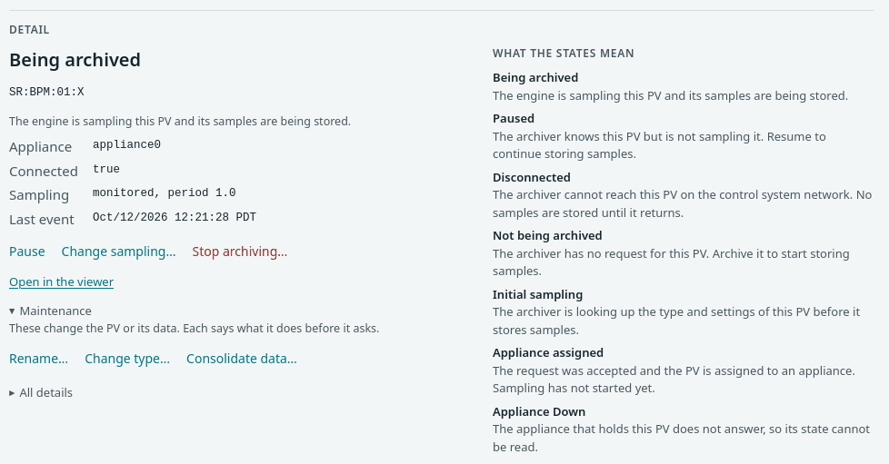
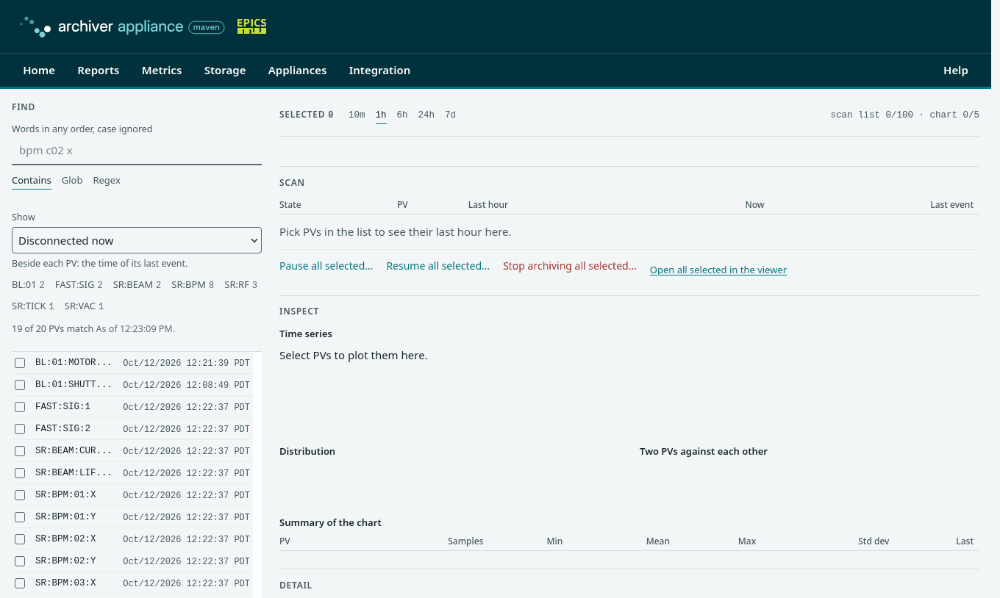

# Operating

## Scope

This page covers daily operation: adding and managing PVs in the web
interface, the PV states, the reports and the System pages, monitoring,
aliases, named flags, backup and recovery, and inspecting the CA and PVA
traffic.

**Out of scope:** each page of the web interface with its limits and its
site skin ([Management interface](interface.md)), the same operations
from scripts ([Scripting](scripting.md)) and the logs
([Logging](logging.md)).

## The web interface

The web interface is served by the mgmt web application at
`http://<host>:17665/mgmt/ui/index.html`. Every page carries one menu
bar, named by task; the entry of the page in view is marked:

| Menu entry | Opens | Purpose |
| --- | --- | --- |
| Archive PVs | the Work page | archive a PV and pause, resume or stop it |
| Browse PVs | the Work page | find PVs, scan them, inspect their data; the reports are the **Show** list of the Find panel |
| System | System: Overview | status monitoring: the verdict on the appliance, then Operations and Retrieval performance |
| Help | the help page | how to use each page, the PV states, the management API reference ([Scripting](scripting.md)) and a link to this manual |
| Analyzer | the data viewer | the data viewer of the retrieval web application ([Retrieving data](retrieval.md#the-data-viewer)) |

On a screen 720 px wide or narrower the entries fold behind a **Menu**
button and open as one column. The **External servers** tab of System
lists the other archiver clusters this appliance serves data for. The
addresses of the earlier pages (`reports.html`, `metrics.html`,
`storage.html`, `appliance.html`, `integration.html`) forward to their
place.

The Work page is the page of daily use. The next figure shows it with
three PVs selected: the Find panel on the left, the scan list with a
trend of each PV, the chart with its distribution, scatter plot and
statistics, and the detail of the first PV.



The data viewer shows PVs as charts per unit. A link on the Work page
opens the selected PVs in it, over the window of the chart
([Retrieving data](retrieval.md#the-data-viewer)).

## Adding PVs

1. On the Work page, type the PV name in **Find**. The name is a base
   name with an optional field, such as `SR:BPM:01:X` or
   `SR:BPM:01:X.RBV`. A name that starts with `pva://` is archived over
   PVAccess.
2. When no archived PV matches the words and the text is a valid PV
   name, the panel offers **Archive** with that name. Select it.
3. Choose the sampling mode, **Monitor** (store each change) or **Scan**
   (store at a fixed period), and the sampling period in seconds.
4. Select **Archive**.



The dialog archives one name. To archive many PVs at once, send the
names to the `archivePV` call ([Scripting](scripting.md)).

The appliance looks up the type and settings of the new PV, applies the
policy, and starts archiving it. The page reads the state of the
selected PVs every 3 s while a request is unfinished and every 20 s
otherwise.

| State | Meaning |
| --- | --- |
| Initial sampling | the archiver looks up the type and settings of the PV before it stores samples |
| Appliance assigned | the request is accepted and the PV is assigned to an appliance; sampling has not started |
| Being archived | the engine samples the PV and stores its samples |
| Paused | the archiver knows the PV but does not sample it |
| Disconnected | the archiver cannot reach the PV on the control system network; no samples are stored until it returns |
| Not being archived | the archiver has no request for the PV |
| Appliance Down | the appliance that holds the PV does not answer, so its state cannot be read |

A PV that never connects stays in Initial sampling. Its detail offers
**Abort the request**.

## Managing a PV

Select a PV in the list; its detail appears at the bottom of the Work
page with the actions that apply to its state.



| Action | Condition | Effect |
| --- | --- | --- |
| Pause, Resume | the PV is archived | stops or restarts sampling; the configuration and the stored data stay |
| Change sampling | the PV is archived or paused | sets the method and the period; a running PV takes them at once and the stored data does not change |
| Stop archiving | the PV is archived or paused | pauses the PV, removes it from the archiver and, when ticked, deletes its stored data |
| Abort the request | the PV is in Initial sampling or Appliance assigned | cancels the archive request |
| Rename | none; the PV is paused first | copies the settings and the data to the new name; both names stay paused until each is checked and resumed |
| Change type | none; the PV is paused first | converts the stored data of every store to the new type, in place; it asks for the confirmation that a backup exists |
| Consolidate data | none; the PV is paused first | moves the data of the earlier stores up to the chosen store |

**Pause all selected**, **Resume all selected** and **Stop archiving all
selected** apply an action to every PV of the scan list. **All details**
lists everything the archiver reports about the PV.

## Reports and System pages

The **Show** list of the Find panel selects the PVs of one report. The
reports are:

- PVs that may not exist (never connected) and PVs waiting for their
  first connection;
- PVs that are disconnected now and the PVs with the most connection
  drops or the longest silence;
- paused PVs;
- the PVs with the highest event rate and the highest storage rate, and
  the PVs that use the most storage;
- recently added and recently changed PVs;
- PVs that dropped events because of a wrong time stamp, a buffer
  overflow or a type change.



The System pages answer the questions of the person who looks after the
appliance. **Overview** gives three verdicts, storing samples, reading
data and room left, and one row per measure with its value, its status
and a link to the detail. The **i** button beside a measure opens a card
with what the measure means and where to act.


**Operations** shows the samples, the dropped samples, the write path,
the stores and ETL, the processes and the configuration in effect, and
names the setting to change for each remedy. **Retrieval performance**
measures a data request from the browser and shows what the server
reports. [Management interface](interface.md#what-the-system-pages-judge)
lists the judgements and their starting values.

When a store runs full, ETL follows the `OutOfSpaceHandling` key
([Configuration](configuration.md#archapplproperties)).

## Monitoring

- **Logs:** watch for ERROR and FATAL lines, and for `OutOfMemoryError`,
  with `journalctl -p err` ([Logging](logging.md)). An error in the engine
  or ETL needs attention; one in retrieval or mgmt may come from a bad
  request.
- **Free space** of each store, from **Stores** on the System Operations
  page or the host.
- **Disconnected PVs**, from the **Disconnected now** selection of the
  Show list or the `getCurrentlyDisconnectedPVs` call. Pausing PVs that
  stay disconnected, and resuming paused PVs that are alive again,
  keeps this list short.
- **Dropped samples**, from the Samples lost section of the System
  Operations page or the three selections of the Show list that name
  dropped events. The Overview shows a Problem verdict while any PV
  dropped a sample.
- **Type changes:** when a PV changes its data type, the appliance stops
  archiving its new samples; the **Most events dropped by a type change**
  selection lists them. Either rename the paused PV and archive it again
  under its name, which keeps the old data under the new name, or
  convert its archived data with **Change type** on the paused PV, which
  rewrites the data (back it up first), and then resume it.

## Aliases

When a PV is added under an alias, the appliance reads the PV's `NAME`
field, archives it under the real name, and records the alias in the
`PVAliases` table. Retrieval and the management calls then work under
both names; the Work page lists the real name.

## Named flags

Named flags are appliance-wide boolean values, all false at startup.
They are set with the `setNamedFlag` call ([Scripting](scripting.md)) or
loaded at startup from a properties file named by the
`org.epics.archiverappliance.config.NamedFlags.readFromFile` key.

- `SKIP_<store>_FOR_RETRIEVAL`, for example `SKIP_LTS_FOR_RETRIEVAL`,
  leaves that store out of retrieval, for example while the LTS storage
  is unavailable.
- A store URL can name a flag in `etlIntoStoreIf` or `etlOutofStoreIf`
  ([Configuration](configuration.md#stores)).

## Backup

- **The configuration database** holds the archiving configuration of
  every PV. Back it up with the database's own tools, for example
  `mysqldump` for MariaDB or a copy of the file for SQLite while the
  appliance is stopped.
- **The stores** hold the samples as ordinary files, one per PV and
  partition, and can be backed up with file tools.
- The `exportConfig` call returns the `PVTypeInfo` records of the
  appliance as JSON, and `importConfig` loads such a file into an
  appliance that does not yet archive those PVs. Aliases and named
  flags are not part of the export.

## Recovering a lost appliance

Install a new host with the same identity in `appliances.xml`, restore
the configuration database from its backup, restore or remount the
stores, and start the appliance; it archives the PVs of the restored
configuration. Giving the new host the IP address of the old one avoids
clients holding a cached address.

## Inspecting the CA and PVA traffic

A packet capture between the appliance and an IOC shows searches,
connections and subscriptions:

```bash
tcpdump -i <interface> 'host <ioc> and host <appliance>' -w capture.pcap
```

The [cashark](https://github.com/mdavidsaver/cashark/) plugin decodes CA
and PVA in Wireshark and `tshark`. **All details** of a PV on the Work
page lists the CA channel ID, the server channel ID and the subscription
ID of its channel, and pausing and resuming the PV during the capture
shows the channel's whole life cycle.
