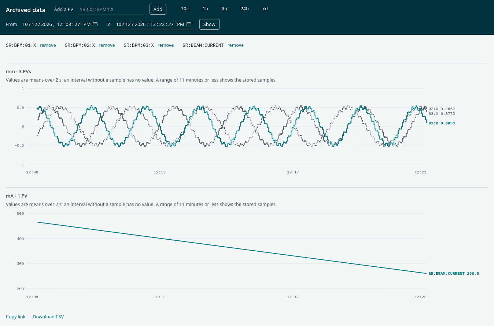

# Retrieving data

## Scope

This page covers the data retrieval URLs of the retrieval web
application, their parameters and formats, server-side post-processing,
the data viewer, and reading data from Phoebus, MATLAB and Python.

**Out of scope:** the management calls ([Scripting](scripting.md)) and
the byte layout of the raw format ([Developer guide](developer.md#pbhttp)).

## The URL

Data is fetched from the `data_retrieval_url` of `appliances.xml`
followed by `/data/<method>.<format>`:

```
http://archiver.example.org:17668/retrieval/data/getData.json?pv=TEST:PV:1&from=2026-09-24T00:00:00.000Z&to=2026-09-25T00:00:00.000Z
```

| Method | HTTP | Returns |
| --- | --- | --- |
| `getData.<format>` | GET | the samples of one PV in a time range |
| `getDataForPVs.<format>` | GET, POST | the samples of several PVs; formats `json`, `raw`, `jplot` and `qw` |
| `getDataAtTime` | POST | the value of each PV at one instant, as JSON |

## Parameters of getData

| Parameter | Meaning | Default |
| --- | --- | --- |
| `pv` | the PV name; a trailing `.VAL` is removed | required |
| `from` | start of the range | one day before `to` |
| `to` | end of the range | one hour after now |
| `timeranges` | comma-separated start and end times of several ranges, instead of `from` and `to` | none |
| `fetchLatestMetadata` | `true` adds the PV's current metadata from the engine | `false` |
| `pp` | the operator for each PV whose name carries none ([Post-processing](#post-processing)) | none, raw data |
| `usereduced` | `true` returns reduced data when no post-processor is given | `false` |
| `retiredPVTemplate` | for a PV no longer archived, the name of an archived PV whose configuration is used to read its files | none |
| `skipExternalServers` | `true` leaves out external data servers ([Redundancy](redundancy.md)) | `false` |

The property `org.epics.archiverappliance.retrieval.DefaultUseReducedPostProcessor`
sets the reduction of `usereduced` ([Configuration](configuration.md)).
The shipped `archappl.properties` sets `TwoWeekRaw`, which returns raw
data for the last two weeks and `firstSample` data for older times. When
the property is unset, the reduction is `firstSample`.

Times are ISO 8601 instants in UTC, such as `2026-09-24T08:00:00.000Z`,
or ISO 8601 date times with an offset, such as
`2026-09-24T01:00:00-07:00`, URL-encoded when needed; the `+` of an
offset such as `+09:00` is sent as `%2B`, because an unencoded `+`
arrives as a space. A time that cannot be parsed returns HTTP 400.
The appliance stores UTC and the machine readable responses return UTC;
clients convert to local time. The `txt` response writes the time zone
of the server ([Times](time-handling.md)).

For `getDataForPVs`, repeat `pv` in a GET, or send the names in a POST
body as a JSON array or as one name per line.

For `getDataAtTime`, send the PV names in the POST body in the same way,
with these parameters in the URL:

| Parameter | Meaning | Default |
| --- | --- | --- |
| `at` | the instant, ISO 8601 | now |
| `searchPeriod` | how far back to search for a sample, a date-based ISO 8601 period such as `P1D` or `P2W`; a period with a time part, such as `PT12H`, returns HTTP 500 | `P1D` |
| `includeProxies` | `true` also asks external appliances ([Redundancy](redundancy.md)) | `false` |

```bash
curl -s -X POST -H "Content-Type: application/json" -d '["TEST:PV:1", "TEST:PV:2"]' "http://archiver.example.org:17668/retrieval/data/getDataAtTime.json?at=2026-09-24T08:00:00.000Z"
```

### POST bodies

The `Content-Type` of a POST decides how the body is read:

| Content-Type | Body |
| --- | --- |
| exactly `application/json` | a JSON array of names, or of objects with a `pv` member |
| `application/x-www-form-urlencoded` | the form field `pv`, a comma-separated list such as `pv=TEST:PV:1,TEST:PV:2`; a body without `pv` returns HTTP 500 |
| any other type, such as `text/plain` or `application/json; charset=utf-8` | one name per line |
| none | no names |

`curl -d` without a `Content-Type` header sends
`application/x-www-form-urlencoded`.

### The getDataAtTime response

The response is a JSON object with one member per PV that has a sample.
A PV without a sample is left out. The order of the members is not
fixed. A development appliance answers this request:

```bash
curl -s -X POST -H "Content-Type: application/json" -d '["SR:BPM:01:X"]' "http://archiver.example.org:17668/retrieval/data/getDataAtTime?at=2026-10-19T12:00:00Z"
```

with this object:

```json
{"SR:BPM:01:X":{"severity":0,"val":-0.014319805167865896,"nanos":72657017,"meta":{"HIHI":"0.0","HIGH":"0.0","LOLO":"0.0","PREC":"3","LOPR":"0.0","HOPR":"0.0","DESC":"beam position X","cnxlostepsecs":"0","EGU":"mm","LOW":"0.0","startup":"true","DBRType":"DBR_SCALAR_DOUBLE","cnxregainedepsecs":"1792386553"},"secs":1792411199,"status":0}}
```

| Member | Content |
| --- | --- |
| `secs`, `nanos` | the time of the sample: epoch seconds, and the nanoseconds within that second |
| `val` | the value; a number, a string, or an array for a waveform |
| `severity`, `status` | the alarm severity and status numbers |
| `meta` | `DBRType`, and the metadata fields stored with the sample, such as `EGU` |

## Formats

| Format | Content type | Content |
| --- | --- | --- |
| `json` | `application/json` | a JSON array with one object per PV: `meta` and `data`; a sample in `data` has `secs`, `val`, `nanos`, `severity` and `status`, and `fields` when the sample carries field values |
| `csv` | `text/csv` | one line per sample, one PV only, without a header line: `secs,value,severity,status,nanos`; an empty line ends the file |
| `txt` | `text/plain` | readable text, useful for debugging |
| `mat` | `application/matlab` | a MATLAB file |
| `raw` | `application/x-protobuf` | the PB/HTTP binary protocol |
| `svg` | `image/svg+xml` | a simple plot |
| `jplot`, `qw` | `application/json` | JSON shapes for plotting clients |
| `flx` | `text/xml` | an XML shape |

## Post-processing

A post-processor reduces the data on the server. Write it around the PV
name, with its arguments either joined to the operator by underscores
or after the PV name, separated by commas; the two requests below are
the same. The bin size is in seconds and defaults to 900.

```
getData.json?pv=mean_3600(TEST:PV:1)
```
```
getData.json?pv=mean(TEST:PV:1,3600)
```

| Operator | Result per bin |
| --- | --- |
| `firstSample`, `lastSample` | the first or last sample |
| `firstFill`, `lastFill` | the first or last sample, carried into empty bins |
| `mean`, `median`, `min`, `max`, `count` | the statistic of the samples |
| `std`, `variance`, `popvariance`, `rms`, `jitter`, `kurtosis`, `skewness` | the statistic of the samples |
| `stats` | mean, standard deviation, minimum, maximum and count together |
| `errorbar` | mean with its standard deviation |
| `linear`, `loess` | interpolated values |
| `flyers`, `ignoreflyers` | only, or all but, the samples far from the mean; second argument is the number of standard deviations, default 3 |
| `nth` | every n-th sample; the argument is n, default 900 |
| `ncount` | the number of samples in the whole range; no argument |
| `deadBand` | like the record's `ADEL`: a sample is kept when it differs from the last kept one by at least the argument, default 1 |
| `optimized`, `optimLastSample` | about the given number of points over the range, default 1000 |
| `caplotbinning` | up to four samples per bin (first, last, minimum, maximum), as the Channel Archiver plot mode |

The statistics operators, `optimized` and `optimLastSample` fill empty
bins with the previous value; the variants with `Sample` appended, such
as `meanSample`, leave them empty.

In a request with several PVs, each PV takes the operator in its own name
or, when its name carries none, the operator of `pp`. The operator of one
PV never reaches another.

The server checks every operator before it reads data. The name before
the first underscore must be an operator of the table or its `Sample`
variant. The argument must be a number in the range of the operator:

| Operator | Argument |
| --- | --- |
| `firstSample`, `lastSample`, `firstFill`, `lastFill`, the statistics operators, `caplotbinning` | the bin size, an integer of at least 1 |
| `flyers`, `ignoreflyers` | the bin size as above, then optionally a finite number above 0 |
| `nth` | n, an integer of at least 1 |
| `optimized`, `optimLastSample` | the number of points, an integer of at least 1 |
| `deadBand` | a finite number of at least 0 |
| `ncount` | none |

An empty or blank `pp` and `pp=pb` return raw data. `twoweek` and
`extraFields` are the names that one appliance sends to another; the
server accepts them and treats them like an empty `pp`. An unknown
operator, such as `bogus` or `meanx`, and a bad argument, such as `mean_`,
`mean_0`, `mean_abc`, `mean_60.5` or `nth_-1`, return HTTP 400 on
`getData` and `getDataForPVs`. The body names the operator and the
reason. The PVAccess retrieval fails the call with the same message.

`optimLastSample` over a range shorter, in seconds, than its number of
points answers an empty body.

## The data viewer

The retrieval web application serves a data viewer at
`http://archiver.example.org:17668/retrieval/ui/viewer/archViewer.html`.
It reads the data of its own appliance through the `getData.json` URL
and draws one chart per unit, with at most eight PVs in a chart:

```
http://archiver.example.org:17668/retrieval/ui/viewer/archViewer.html?pv=TEST:PV:1&pv=TEST:PV:2&from=2026-09-24T00:00:00.000Z&to=2026-09-24T01:00:00.000Z
```



| Part | Use |
| --- | --- |
| `pv` (repeatable) | the PVs to show; the **Add a PV** box suggests archived names |
| `from`, `to` | the window, ISO 8601; without them the viewer shows the last hour |
| The range buttons and the **From** and **To** fields | change the window |
| **Copy link** | copies an address that reproduces the view |
| **Download CSV** | the values as drawn, with the column `interval_seconds` |

A window of up to 11 minutes shows the stored samples. A longer window
shows means over equal intervals, requested as `meanSample_N`, and the
chart says so. An interval without a sample has no value and the line
stops there, so a lost connection is never drawn as a held value. The
Browse PVs page of the web interface opens the plotted PVs, or all the PVs of its
table, in the viewer through the Analyzer entry
([Operating](operating.md#the-web-interface)).

## Phoebus Data Browser

The Phoebus Data Browser reads the appliance over PB/HTTP. Replace
`http` by `pbraw` in the `data_retrieval_url` and list it in the Phoebus
preferences file (`settings.ini`):

```ini
org.csstudio.trends.databrowser3/urls=pbraw://archiver.example.org:17668/retrieval|Appliance
org.csstudio.trends.databrowser3/archives=pbraw://archiver.example.org:17668/retrieval|Appliance
```

`urls` lists the data servers offered in the Data Browser, and
`archives` the default ones for newly added channels. Several servers are
separated by `*`; the part after `|` is the name shown.

## MATLAB

```matlab
url = 'http://archiver.example.org:17668/retrieval/data/getData.mat';
websave('temp.mat', url, 'pv', 'TEST:PV:1', 'from', '2026-09-24T00:00:00.000Z', 'to', '2026-09-25T00:00:00.000Z');
dat = load('temp.mat');
delete('temp.mat');
```

The file holds a `header` structure and a `data` structure with the
fields `epochSeconds` (UTC seconds), `values` (a row per sample, with one
column per waveform element), `nanos` and `isDST`, the daylight saving
state of each sample in the time zone of the server.

## Python

```python
import requests

url = "http://archiver.example.org:17668/retrieval/data/getData.json"
params = {"pv": "TEST:PV:1", "from": "2026-09-24T00:00:00.000Z", "to": "2026-09-25T00:00:00.000Z"}
data = requests.get(url, params=params, timeout=30).json()
for sample in data[0]["data"]:
    print(sample["secs"], sample["nanos"], sample["val"])
```
