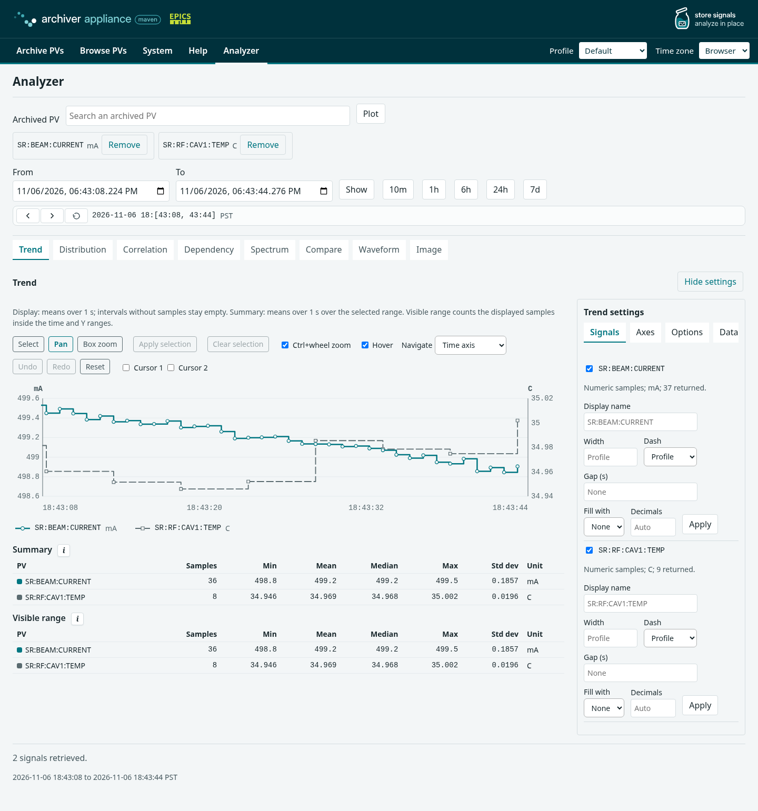

# Retrieving data

## Scope

This page covers the data retrieval URLs of the retrieval web
application, their parameters and formats, server-side post-processing,
the data viewer, and reading data from Phoebus, MATLAB and Python.

**Out of scope:** the management calls ([Scripting](scripting.md)) and
the byte layout of the raw format ([Developer guide](developer.md#pbhttp)).

## The URL

Data is fetched from the `data_retrieval_url` of `appliances.xml`
followed by `/data/<method>.<format>`:

```
http://archiver.example.org:17668/retrieval/data/getData.json?pv=TEST:PV:1&from=2026-09-24T00:00:00.000Z&to=2026-09-25T00:00:00.000Z
```

| Method | HTTP | Returns |
| --- | --- | --- |
| `getData.<format>` | GET | the samples of one PV in a time range |
| `getDataForPVs.<format>` | GET, POST | the samples of several PVs; formats `json`, `raw`, `jplot` and `qw` |
| `getDataAtTime` | POST | the value of each PV at one instant, as JSON |

## Parameters of getData

| Parameter | Meaning | Default |
| --- | --- | --- |
| `pv` | the PV name; a trailing `.VAL` is removed | required |
| `from` | start of the range | one day before `to` |
| `to` | end of the range | one hour after now |
| `timeranges` | comma-separated start and end times of several ranges, instead of `from` and `to` | none |
| `fetchLatestMetadata` | `true` adds the PV's current metadata from the engine | `false` |
| `pp` | the operator for each PV whose name carries none ([Post-processing](#post-processing)) | none, raw data |
| `usereduced` | `true` returns reduced data when no post-processor is given | `false` |
| `retiredPVTemplate` | for a PV no longer archived, the name of an archived PV whose configuration is used to read its files | none |
| `skipExternalServers` | `true` leaves out external data servers ([Redundancy](redundancy.md)) | `false` |

The property `org.epics.archiverappliance.retrieval.DefaultUseReducedPostProcessor`
sets the reduction of `usereduced` ([Configuration](configuration.md)).
The shipped `archappl.properties` sets `TwoWeekRaw`, which returns raw
data for the last two weeks and `firstSample` data for older times. When
the property is unset, the reduction is `firstSample`.

Times are ISO 8601 instants in UTC, such as `2026-09-24T08:00:00.000Z`,
or ISO 8601 date times with an offset, such as
`2026-09-24T01:00:00-07:00`, URL-encoded when needed; the `+` of an
offset such as `+09:00` is sent as `%2B`, because an unencoded `+`
arrives as a space. A time that cannot be parsed returns HTTP 400.
The appliance stores UTC and the machine readable responses return UTC;
clients convert to local time. The `txt` response writes the time zone
of the server ([Times](time-handling.md)).

For `getDataForPVs`, repeat `pv` in a GET, or send the names in a POST
body as a JSON array or as one name per line.

For `getDataAtTime`, send the PV names in the POST body in the same way,
with these parameters in the URL:

| Parameter | Meaning | Default |
| --- | --- | --- |
| `at` | the instant, ISO 8601 | now |
| `searchPeriod` | how far back to search for a sample, a date-based ISO 8601 period such as `P1D` or `P2W`; a period with a time part, such as `PT12H`, returns HTTP 500 | `P1D` |
| `includeProxies` | `true` also asks external appliances ([Redundancy](redundancy.md)) | `false` |

```bash
curl -s -X POST -H "Content-Type: application/json" -d '["TEST:PV:1", "TEST:PV:2"]' "http://archiver.example.org:17668/retrieval/data/getDataAtTime.json?at=2026-09-24T08:00:00.000Z"
```

### POST bodies

The `Content-Type` of a POST decides how the body is read:

| Content-Type | Body |
| --- | --- |
| exactly `application/json` | a JSON array of names, or of objects with a `pv` member |
| `application/x-www-form-urlencoded` | the form field `pv`, a comma-separated list such as `pv=TEST:PV:1,TEST:PV:2`; a body without `pv` returns HTTP 500 |
| any other type, such as `text/plain` or `application/json; charset=utf-8` | one name per line |
| none | no names |

`curl -d` without a `Content-Type` header sends
`application/x-www-form-urlencoded`.

### The getDataAtTime response

The response is a JSON object with one member per PV that has a sample.
A PV without a sample is left out. The order of the members is not
fixed. A development appliance answers this request:

```bash
curl -s -X POST -H "Content-Type: application/json" -d '["SR:BPM:01:X"]' "http://archiver.example.org:17668/retrieval/data/getDataAtTime?at=2026-10-19T12:00:00Z"
```

with this object:

```json
{"SR:BPM:01:X":{"severity":0,"val":-0.014319805167865896,"nanos":72657017,"meta":{"HIHI":"0.0","HIGH":"0.0","LOLO":"0.0","PREC":"3","LOPR":"0.0","HOPR":"0.0","DESC":"beam position X","cnxlostepsecs":"0","EGU":"mm","LOW":"0.0","startup":"true","DBRType":"DBR_SCALAR_DOUBLE","cnxregainedepsecs":"1792386553"},"secs":1792411199,"status":0}}
```

| Member | Content |
| --- | --- |
| `secs`, `nanos` | the time of the sample: epoch seconds, and the nanoseconds within that second |
| `val` | the value; a number, a string, or an array for a waveform |
| `severity`, `status` | the alarm severity and status numbers |
| `meta` | `DBRType`, and the metadata fields stored with the sample, such as `EGU` |

## Formats

| Format | Content type | Content |
| --- | --- | --- |
| `json` | `application/json` | a JSON array with one object per PV: `meta` and `data`; a sample in `data` has `secs`, `val`, `nanos`, `severity` and `status`, and `fields` when the sample carries field values |
| `csv` | `text/csv` | one line per sample, one PV only, without a header line: `secs,value,severity,status,nanos`; an empty line ends the file |
| `txt` | `text/plain` | readable text, useful for debugging |
| `mat` | `application/matlab` | a MATLAB file |
| `raw` | `application/x-protobuf` | the PB/HTTP binary protocol |
| `svg` | `image/svg+xml` | a simple plot |
| `jplot`, `qw` | `application/json` | JSON shapes for plotting clients |
| `flx` | `text/xml` | an XML shape |

## Post-processing

A post-processor reduces the data on the server. Write it around the PV
name, with its arguments either joined to the operator by underscores
or after the PV name, separated by commas; the two requests below are
the same. The bin size is in seconds and defaults to 900.

```
getData.json?pv=mean_3600(TEST:PV:1)
```
```
getData.json?pv=mean(TEST:PV:1,3600)
```

The parameter `pp` has no PV name, so it takes the underscore form only,
such as `pp=mean_3600`. The form with commas belongs to the PV name:
`pp=mean(3600)` answers HTTP 400 as an unknown operator. When a request
carries several `pp` parameters, the first one counts.

The server turns the comma form into the underscore form before it checks
it, so the error for `mean(TEST:PV:1,abc)` names the operator `mean_abc`.
Giving the argument in both forms, as in `mean_60(TEST:PV:1,60)`, is an
error and is reported as `mean_60_60`. A `+` in an operator is read as a
blank unless it is written `%2B`.

| Operator | Result per bin |
| --- | --- |
| `firstSample`, `lastSample` | the first or last sample |
| `firstFill`, `lastFill` | the first or last sample, carried into empty bins |
| `mean`, `median`, `min`, `max`, `count` | the statistic of the samples |
| `std`, `variance`, `popvariance`, `rms`, `jitter`, `kurtosis`, `skewness` | the statistic of the samples |
| `stats` | mean, standard deviation, minimum, maximum and count together |
| `errorbar` | mean with its standard deviation |
| `linear`, `loess` | interpolated values |
| `flyers`, `ignoreflyers` | only, or all but, the samples far from the mean; second argument is the number of standard deviations, default 3 |
| `nth` | every n-th sample; the argument is n, default 900 |
| `ncount` | the number of samples in the whole range; no argument |
| `deadBand` | like the record's `ADEL`: a sample is kept when it differs from the last kept one by more than the argument, default 1 |
| `optimized`, `optimLastSample` | about the given number of points over the range, default 1000 |
| `caplotbinning` | up to four samples per bin (first, last, minimum, maximum), as the Channel Archiver plot mode |

The operators from `mean` to `loess` in the table, `optimized` and
`optimLastSample` fill empty bins with the previous value, except `count`,
which writes 0 for an empty bin; the variants with `Sample` appended, such
as `meanSample`, leave them empty. The other
operators have no `Sample` variant. Of `optimized` and `optimLastSample`
only `optimized` has one, `optimizedSample`; `optimLastSampleSample` is
accepted and fills the empty bins like `optimLastSample`.

The event of a bin is stamped at the middle of the bin. When the request ends inside a bin that holds samples and the middle of that bin lies after the end, the event of that bin is stamped at the end of the request, so that the event stays inside the requested window and the newest samples are not left out. The bins after it keep their stamp and are not returned.

In a request with several PVs, each PV takes the operator in its own name
or, when its name carries none, the operator of `pp`. The operator of one
PV never reaches another.

The server checks every operator in effect before it reads data; an
operator of `pp` that no PV uses is not checked. The name before the
first underscore must be an operator of the table, or the `Sample`
variant of an operator that has one. The spelling is exact for the name and for integer arguments: the
check is case sensitive and accepts no blank before or after them. The
argument must be a number in the range of the operator:

| Operator | Argument |
| --- | --- |
| `firstSample`, `lastSample`, `firstFill`, `lastFill`, `mean`, `median`, `min`, `max`, `count`, `std`, `variance`, `popvariance`, `rms`, `jitter`, `kurtosis`, `skewness`, `stats`, `errorbar`, `linear`, `loess`, `caplotbinning` | the bin size, an integer from 1 to 2147483647 |
| `flyers`, `ignoreflyers` | the bin size as above, then optionally a number above 0 that fits a 32-bit float |
| `nth` | n, an integer from 1 to 2147483647 |
| `optimized`, `optimLastSample` | the number of points, an integer from 1 to 2147483647 |
| `deadBand` | a finite number of at least 0 |
| `ncount` | none |

An integer above 2147483647 answers the same message as 0, which names
"an integer of at least 1". A valid but very large point count, in the millions,
can also empty the answer without an error. A count whose declared size
exceeds the request budget is refused with HTTP 400; see
[Limits on a request](#limits-on-a-request).

An empty or blank `pp` and `pp=pb` return raw data. `twoweek` and
`extraFields` are the names that one appliance sends to another; the
server accepts them and treats them like an empty `pp`. An unknown
operator, such as `bogus` or `meanx`, and a bad argument, such as `mean_`,
`mean_0`, `mean_abc`, `mean_60.5` or `nth_-1`, return HTTP 400 on
`getData` and `getDataForPVs`. The body is the HTML error page of the
server, and its Message line names the operator and the reason. A
PVAccess call with such an operator gets no answer, so the caller ends at
its own timeout.

`optimLastSample` over a range shorter, in seconds, than its number of
points answers an empty result; with the default of 1000 points that
is every range shorter than 1000 seconds. `json`, `jplot` and `qw` answer an empty
JSON array written over two lines, `csv` one empty line, `flx` an empty `data`
element, `svg` a fragment that is not a valid SVG document, and `raw`,
`txt` and `mat` no bytes. A range
before the first stored sample of a PV answers the same. A range after
the first stored sample that holds no sample answers differently for each
operator: raw data adds the last sample before `from`, while
`optimLastSample` and `nth` answer the PV with an empty `data` array. In a
request with several PVs, one PV
whose `optimLastSample` has more points than the range has seconds makes
the whole response empty, and nothing in the response tells which PV
caused it.

## Limits on a request

Five layers limit a request, from the JVM to the single call:

- The JVM options `-XX:+ExitOnOutOfMemoryError` and
  `-XX:+HeapDumpOnOutOfMemoryError` end a JVM that throws an
  `OutOfMemoryError` and leave a heap dump. They retain evidence and do not
  prevent exhaustion. The [installation page](installing.md#environment)
  gives their handling.
- Two Tomcat valves on the retrieval and management web applications
  answer HTTP 503 at once to a request above the concurrency limit and
  interrupt a request that runs past the interrupt threshold. The
  [installation page](installing.md#environment) lists their properties.
- The retrieval PVAccess service takes at most a set number of calls at a
  time and refuses the next. The valves do not reach PVAccess.
- Three memory checks in the retrieval application refuse a request that
  declares too much, refuse requests while memory is short, and stop the
  largest allocators while memory is short.
- A deadline stops an HTTP request that runs too long.

### How the memory checks decide

The checks read the maximum heap of the JVM, so the limits grow with the
heap. The memory after garbage collection is the usage of the old-generation
pool at its last collection. The checks apply to every HTTP format and to
PVAccess retrieval.

| Check | When it runs | Condition | Answer |
| --- | --- | --- | --- |
| Declared size | Before the request reads data | The size the operator declares exceeds 20 percent of the maximum heap | HTTP 400 |
| Admission | Before the request reads data | The memory after collection exceeds 50 percent of the maximum heap | HTTP 503 |
| Pressure | While the request runs, every 1024 events | The memory after collection exceeds 60 percent of the maximum heap, and the request has allocated more than 1 percent of it | HTTP 503 |

The percentages are defaults. The `retrieval.memory` keys of
[archappl.properties](configuration.md#archapplproperties) set them.

An operator declares a size when it keeps data for each bin or point:
`optimized`, `optimLastSample`, `caplotbinning`, `firstFill`, `lastFill`,
`lastSample`, and the statistics operators `mean`, `median`, `min`, `max`,
`count`, `std`, `variance`, `popvariance`, `rms`, `jitter`, `kurtosis`,
`skewness`, `stats`, `errorbar`, `linear`, and `loess`. The declared size is
the number of bins or points times a byte count for each. A raw read streams
its data and declares nothing, so it completes while there is no memory
pressure, even when it is longer than the heap.

The operators `firstSample`, `deadBand`, `flyers`, and `ignoreflyers` declare
no size either. While they build the result they keep the events they select in
memory. The declared-size check does not count that memory. The pressure check,
which runs while the request reads events, stops such a request with HTTP 503
when the memory after collection passes its threshold.

Admission refuses every new request while the memory after collection stays
above its threshold, and accepts requests again once the data that caused the
state is released. Pressure stops only requests above the allocation floor,
so a request that allocates little keeps running.

The checks ask the JVM for a collection when the old generation or the memory
after collection is above the threshold being checked, at most once every 100
milliseconds. Keep `-XX:+DisableExplicitGC` unset: with it set, the guard
cannot request a collection to recover admission after a load ends.

### Request deadline for HTTP

HTTP retrieval stops a request that runs past a duration limit measured from
servlet entry. The limit is the larger of `archappl.valve.stuckThresholdSeconds`
and `archappl.valve.interruptThresholdSeconds`, 900 seconds by default. The
checks run while the request reads events, writes output, and waits for the
HTTP calls that `getDataAtTime` sends to the engine, to the retrieval service
of each appliance, and to external appliances.

A request that expires before its response starts answers HTTP 503. After the
response starts, the status is already sent, so the server closes the
connection. A blocked socket write ends only when the write returns.

### Errors and their status codes

Each refusal names its condition in the message of the HTTP error page:

| Status | Message begins | Meaning |
| --- | --- | --- |
| 400 | `Retrieval declared size` | The declared size exceeds the request budget |
| 503 | `Retrieval memory admission refused` | The memory after collection is above the admission threshold |
| 503 | `Retrieval memory pressure` | The request was stopped while memory was above the pressure threshold |
| 503 | `Retrieval request deadline exceeded` | The request ran past its deadline |
| 503 | `Retrieval request interrupted` | The thread of the request was interrupted |
| 503 | none; the Tomcat error page | The valve refused a request above the concurrency limit |

When a check stops a request after its response has started, the server closes
the connection. A client sees a connection that closes before the response is
complete, and never a complete answer.

### Calls over PVAccess

A PVAccess call that a memory check refuses or stops, or that finds all call
permits in use, gets no answer, so the caller ends at its own timeout. A
PVAccess client must set a call timeout. The retrieval log names the
condition; a call refused for want of a permit logs a message that begins
`PVAccess retrieval call refused`. The client library logs a warning whose
exception carries the message. The valves and the request deadline cover HTTP only. The PVAccess
service limits its concurrent calls with its own permits, set by
`archappl.valve.pvaConcurrency` (see the [installation page](installing.md#environment)).

## The data viewer

The retrieval web application serves the Analyzer at
`http://archiver.example.org:17668/retrieval/ui/viewer/archViewer.html`.
Trend draws numeric scalar signals together, with one value axis per unit.
It retrieves data from its own appliance through `getData.json`, asks
`getDataAtTime` for the sample before a range when it interpolates, and
links to `getData.csv` and `getData.mat` for the server products.
Its header has the console menu, time zone, and display profile.
The other menu entries navigate to the management address returned by
its own `getApplianceInfo` action.



The tabs are Trend, Distribution, Correlation, Dependency, Spectrum,
Compare, Waveform, and Image. An address that names a view that does
not exist opens Trend.

The analysis tabs read the selected range, so their numbers do not change
when you pan or zoom the Trend. All but Waveform and Image read numeric
scalar samples; Waveform and Image read array PVs, and an array is read
one frame at a time. Each tab refuses an input it cannot use with the
reason, leaving no result of an earlier input on the page.

| Tab or tool | What it shows |
| --- | --- |
| **Trend tools** (under the Trend plot) | For one signal: the **Rate of change** (the value change per second between successive samples, drawn in its own plot), the **Slow trend** (a straight line fitted against time, with its slope and r squared), the **Limits** of the PV (`LOPR`, `HOPR`, `LOW`, `HIGH`, `LOLO`, `HIHI` from `getMetadata`, drawn as reference lines with the time outside them) and a typed **Threshold** with the side that counts as beyond and the time beyond it |
| **Distribution** | For one signal: the summary (samples, minimum, maximum, mean, median, standard deviation, skewness, kurtosis, the errors of the mean and of the standard deviation, quantiles), the **Histogram** with a bin rule (Sturges, Scott, Freedman-Diaconis or a typed count), a normalization and an optional kernel density estimate, the **Box plot**, the **Pattern by hour** and **by weekday** (in the selected zone), the **Time and value** map for a long range, and the values **Beyond k** standard deviations. Under the histogram, **Fit of the histogram** fits one of the eight models (those of the Correlation tab) to the bin counts at the bin centres once you declare that the counts are counts of independent samples: each bin then has a Poisson weight of one over its count, empty bins are left out, the errors come from the covariance as it is, and the curve, its band and the residuals are drawn; a fit of another histogram, or made under a declaration since withdrawn, is cleared |
| **Correlation** | Two signals, **X** and **Y** chosen independently with **Swap**, each in its own unit. The samples are paired at the union of their sample times, each with the value the other signal held there; a held value older than five median spacings, or across a recorded connection loss, is not paired but counted, and the pairing line gives the pairs, the samples of each signal, the spacings and the overlap. The **Scatter plot** has projections, point size and transparency, colour by time and a rectangle that counts and correlates the pairs inside it; the **Profile** is the mean of Y in ten bins of X, and the **Density contour** serves dense data. Pearson's r and Spearman's rho carry their p-values, the cross-correlation runs over lags counted in pairs, and the two trends sit under one another on one time axis. The **Fit** of Y against X offers the line, polynomial, exponential, power, logarithm, sine, Gaussian and Landau models with start values, fixed and bounded parameters and a fit range, and runs from **Run fit**: the parameters with their errors, the chi-square per degree of freedom, R squared, the method, a one-sigma band and the residuals, with the earlier fits listed; a fit made for other pairs, or in another unit, is cleared with a note. **X unit** and **Y unit** show a signal in another prefix of the same base unit as its engineering unit (mm in um, V in mV, kHz in MHz): the values are multiplied by a power of ten and every number, the fit parameters and the derived signal use them; a unit that is not a prefix and a base unit (`mm/s`, `degC`, `Gs`) offers no change. A **Derived signal** is a typed expression over `x` and `y`, or the PV names, drawn as a third trend |
| **Dependency** | Three to twenty signals averaged over one common interval, that of the page or one of 10 seconds to 6 hours chosen in the tab, and aligned on the intervals that every signal has. The summary names the interval, the intervals used and dropped, the share each signal has and the condition number of the correlation matrix. The views are the **Correlation matrix** ordered by hierarchical clustering with its dendrogram, the **Mutual information matrix**, the **Ranking** of the other signals by their mutual information with the chosen target, the **Scatter plot matrix** of the target and the five signals most associated with it, the **Partial correlation**, the **Multiple regression** of the target on the others with each coefficient, its error, its standardised size, R squared and the residuals, and the **Principal components** with their variance. A cell of a matrix opens the Correlation tab with the same range and its two signals. Fewer than three or more than twenty signals, a signal without numeric means or that does not vary, fewer than ten common intervals and a range of more than 100,000 intervals are refused with the reason; signals that move together are named when the partial correlation or the regression cannot be solved. The ranking and the regression describe association, not cause |
| **Compare** | Two ranges of one signal, or two signals: range A is the selected range and range B is proposed as the range of the same duration before it (editable); the two trends side by side, the distributions over one another and normalized, the counts, means and spreads with their differences, and the test of the chosen method (chi-square of the histograms, Kolmogorov-Smirnov, Anderson-Darling) with its statistic and p-value, or the reason it does not apply. Unlike units are shown without an overlay or a test |
| **Spectrum** | For one signal, after linear interpolation to an even interval (the median spacing of the samples unless typed): the **Spectrum** as power spectral density, power spectrum or amplitude spectrum with a window and optional zero padding, the peak frequency with its width, the effective sample rate, the usable duration and the frequency resolution; the **Spectrogram** of overlapping segments; the **Autocorrelation** with the period it finds. A spacing of more than five intervals is a gap that stops the spectrum unless the gap policy interpolates across it. The preparation of the series is written above the plot |
| **Waveform** | For one array PV, a frame at a time (**Previous**, **Next**, the slider over the frames of the range and **Go to time**, which shows the frame at or before the typed time): the array against its element number or against a typed start and step or a companion PV, the frames of the range overlaid or as a heatmap of time against element, the summary values of each frame (maximum and its position, minimum, mean, RMS, sum, centre and half-maximum width) and their series over the range, the **Difference** from a reference frame, the **Spectrum** (the sampling frequency typed or read from a PV, never taken from the rate of the archive; a window, a logarithmic or a linear scale and the peak frequency) and the **Peaks** found by the search of ROOT with the background subtracted. A range of frames is thinned to at most 200 frames and 2,304,000 elements, and the page names the step it took. |
| **Image** | For one array PV with a typed or PV-given width and height (never the length of the array): one frame as a heatmap with a colour bar and iso-lines at 10, 50 and 90 percent, a region chosen with the mouse or typed in stored pixel indices, the total, mean, minimum, peak, centroid and Gaussian size of the region or of the whole frame, the **X** and **Y** projections on the pixel axes of the picture, a background level or the mean of a second region subtracted, the **Difference** from a reference frame, the values over at most 100 frames of the range with **Cancel**, and **Flip X** and **Flip Y**. One frame is read at a time, and a frame of more than 5,529,600 elements is refused before any request. |

An **i** button beside each tool opens a card that states its calculation
and the rules of its refusals.

| Control | Effect |
| --- | --- |
| **Archived PV**, **Plot** | Suggest archived names and add a signal; **Remove** beside its name removes it |
| **From**, **To**, range shortcuts, **Show** | Set the common time window in the selected zone; shortcuts prepare the fields and Show applies them |
| Earlier, Later, Back to the selected range | Move the common window by half its span or return to the selected range |
| Plot tools | **Select** marks a candidate time range and **Apply selection** makes it the selected range; **Pan** moves the window; **Box zoom** zooms to the drawn box; **Ctrl+wheel zoom** and **Hover** are toggles of their own, independent of the drag tool; **Navigate** names the axes Pan, Box zoom and the wheel move (the time axis, one value axis or both); **Undo**, **Redo** and **Reset**; **Cursor 1** and **Cursor 2**, read in the Cursors table under the plot, each with **Pin at cursor**; Shift+click pins the nearest sample; pinned samples are listed with **Unpin** |
| **Signals** | Show or hide a line, read its sample count, unit or retrieval error, and set its display name, width, dash, gap in seconds, the signal to fill to and the decimals |
| **Axes** | Per unit: a fixed Minimum and Maximum, a Soft minimum and Soft maximum, the Scale, the Symmetric log constant, Zero centered, SI prefix and a Label; Auto drops the fixed range |
| **Options** | The retrieval Interval (Automatic, Raw samples or Seconds) and the Min-max band; Line, Y scale, Marks, Window, running average and band; Legend, Tooltip, Tooltip order, Grid, Legend values, Split by unit and Names at the line ends; Y projection |
| **Data** | The Summary of the selected range, the Visible range statistics, and the samples in view (PV, Time, Value, Severity, Status, Source; the first 500 of each PV) |
| **Export** | Data as CSV, Statistics as CSV, Fit result as CSV (the last fit of the Correlation tab, or else of the Distribution tab), Derived signal as CSV, Plot as PNG, Plot as SVG, Address of this view, Server CSV or Server MAT; the range shown or a typed one; the source Samples shown, Raw samples, Optimized bins or Linear interpolation; long or wide layout, severity and status, the value format and decimals, ISO 8601 in the zone or UNIX milliseconds, the unit in the header |

The settings panel sits beside the plot at widths of 1100 pixels and
above, and below it on narrower screens. **Hide settings** gives the
plot the full available width. A drag over the plot follows the active
tool; a drag along an axis changes only that unit's value range. A focused
value axis accepts the arrow keys, plus, minus, and Home. A wheel or pinch
gesture keeps the window between one second and ten years. A double-click
drops the value ranges and returns to the selected range. An **i** button
beside Summary, Visible range, Interval, the chart options and the Export
form opens a card that states the calculation behind it.

The selected range is the one chosen with Show, a shortcut or Apply
selection. Its resolution is resolved once: the stored samples for a
range of up to 700 seconds, otherwise means over whole seconds, about 700
of them (`meanSample_N`, N the span in seconds divided by 700, rounded
up). The Summary counts that dataset and keeps it while you pan or zoom.
Pan, Box zoom and the wheel change the displayed window only; it is
retrieved at the resolution of the window shown, and Visible range counts
the displayed samples inside the time and value ranges. The note above
the plot names both resolutions. Interval forces the stored samples or
means over the typed seconds; the Min-max band draws `minSample_N` and
`maxSample_N` under the mean. An interval without a sample has no value
and the line is not drawn through it; recorded connection losses
interrupt the line. Non-numeric samples are not drawn.

Data as CSV begins with metadata lines (product, source, range, time
format, values), then the columns `time`, `pv`, `value` (`mean`, `min`
and `max` for bins), `severity` and `status`, and `quality` and `reason`
for an interpolation; the wide layout has one column per PV. Optimized
bins ask the retrieval for `meanSample_N`, `minSample_N` and
`maxSample_N`, N being the span divided by the bins, rounded up to whole
seconds. Linear interpolation is a calculation of the page over the raw
samples, one row at every step from the start of the range; the sample
before the range comes from `getDataAtTime`, and no value is made before
the first or after the last sample, across a recorded gap or beyond the
typed gap. Statistics as CSV writes the Visible range or the Summary
table. Server CSV and Server MAT list one retrieval address per PV for the
raw samples or the three operators; the browser holds no copy. Opening an
address exports nothing.

The address is the calling interface of the Analyzer. Its parameters are
declared in `docs/analyzer-address.openapi.json` of the repository
(OpenAPI 3.0.3). A caller needs `pv` alone (repeatable) and may add
`from` and `to` as RFC 3339 times in UTC; the page writes every other
parameter back, `pv` first and the rest in the code-point order of their
names, so that one view has one address. A list is a repeated parameter
(`pv`, `hide`, `pin`) or a comma-separated value (`legendStats`); a
setting of one signal or one unit is a key such as `width[PV]` or
`axisMin[UNIT]`; a duration is ISO 8601 (`sample=PT5S`); a boolean is
`true` or `false`.

| Group | Parameters |
| --- | --- |
| Selection | `pv`, `from`, `to`, `selectedFrom`, `selectedTo`, `sample`, `interval`, `minMax`, `view`, `tz`, `profile` |
| Chart options | `shape`, `yscale`, `marks`, `avg`, `band`, `window`, `yproj`; `yrange` of earlier links is read and not written |
| Tools and references | `drag`, `wheel`, `hover`, `nav`, `navUnit`, `cursor1`, `cursor2`, `pin` (`PV@time`) |
| Display | `split`, `legend`, `legendStats`, `tooltip`, `tooltipSort`, `grid`, `endLabels`, `hide` |
| Per signal | `width[PV]`, `dash[PV]`, `gap[PV]`, `fill[PV]`, `decimals[PV]`, `name[PV]` |
| Per unit | `axisScale[UNIT]`, `axisSymlog[UNIT]`, `axisMin[UNIT]`, `axisMax[UNIT]`, `axisSoftMin[UNIT]`, `axisSoftMax[UNIT]`, `axisZero[UNIT]`, `axisPrefix[UNIT]`, `axisLabel[UNIT]` |
| Export | `export[product]`, `export[range]`, `export[from]`, `export[to]`, `export[source]`, `export[bins]`, `export[step]`, `export[gap]`, `export[layout]`, `export[alarms]`, `export[values]`, `export[decimals]`, `export[time]`, `export[units]`, `export[stats]` |
| Analysis tools | `distribution[signal]`, `distribution[view]`, `distribution[rule]`, `distribution[bins]`, `distribution[normalize]`, `distribution[kde]`, `distribution[sigma]`; `trend[signal]`, `trend[rate]`, `trend[fit]`, `trend[limits]`, `trend[threshold]`, `trend[side]`; `compare[mode]`, `compare[a]`, `compare[b]`, `compare[method]`, `compare[from]`, `compare[to]`; `spectrum[signal]`, `spectrum[view]`, `spectrum[interval]`, `spectrum[gaps]`, `spectrum[window]`, `spectrum[output]`, `spectrum[log]`, `spectrum[padding]`, `spectrum[segment]`, `spectrum[overlap]`; `distribution[fit]` (the model of the histogram fit); `correlation[x]`, `correlation[y]`, `correlation[view]`, `correlation[size]`, `correlation[opacity]`, `correlation[time]`, `correlation[lags]`, `correlation[brush]`, `correlation[model]`, `correlation[fitFrom]`, `correlation[fitTo]`, `correlation[xUnit]`, `correlation[yUnit]`; `dependency[target]`, `dependency[view]`, `dependency[interval]` (seconds, or `auto` for the interval of the page); `waveform[signal]`, `waveform[view]`, `waveform[axis]`, `waveform[axisStart]`, `waveform[axisStep]`, `waveform[axisUnit]`, `waveform[axisPv]`, `waveform[frame]`, `waveform[overlay]`, `waveform[value]`, `waveform[reference]`, `waveform[fsSource]`, `waveform[fs]`, `waveform[fsPv]`, `waveform[window]`, `waveform[scale]`, `waveform[sigma]`, `waveform[threshold]`, `waveform[searchBackground]`, `waveform[markov]`, `waveform[averageWindow]`, `waveform[deconvolution]`, `waveform[backgroundIterations]`, `waveform[backgroundDirection]`, `waveform[peakView]`; `image[signal]`, `image[view]`, `image[sizeSource]`, `image[width]`, `image[height]`, `image[widthPv]`, `image[heightPv]`, `image[frame]`, `image[x0]`, `image[x1]`, `image[y0]`, `image[y1]`, `image[background]`, `image[level]`, `image[bx0]`, `image[bx1]`, `image[by0]`, `image[by1]`, `image[flipX]`, `image[flipY]`, `image[reference]`, `image[seriesValue]`; a default is not written, a signal defaults to the first `pv`, `correlation[y]` to the first `pv` other than X, and `compare[from]` and `compare[to]` are written only when range B was set by hand; a companion PV (`waveform[axisPv]`, `waveform[fsPv]`, `image[widthPv]`, `image[heightPv]`) is written only with the source that uses it, and `waveform[frame]`, `waveform[reference]`, `image[frame]` and `image[reference]` are times in the form of `compare[from]` |

A tool option takes the value of its control as a lower-case name
(`spectrum[window]=blackman`, `distribution[rule]=count`,
`compare[method]=ks`), a count or a number as digits
(`spectrum[segment]=256`, `distribution[bins]=50`, `trend[threshold]=12`,
`spectrum[interval]=20` in seconds), a check box as `true` or `false`
(`trend[fit]=true`) and a signal as its PV name; the declaration lists
every value. A fit runs only from its button: the address restores the
model and the fit range, not the start values, the fixed parameters or
the bounds, and never a result. Copy link writes all of these options;
an address is typed by hand only
when it is made outside the page, as in a link from another tool.

A parameter takes its first occurrence; an invalid value falls back to
its default, a pair (`from` and `to`, a fixed range, a typed export
range) applies whole or not at all, and an unknown parameter is ignored
and not written back. A fixed range makes an axis fixed, a soft bound
makes it soft, and the page writes the bounds of the policy in force; the
`yrange` of earlier links is read, not written. A pin names a sample as
`PV@time` with its nanoseconds and is restored from the display data, or
listed as unavailable; a cursor keeps the digits it was given until it
moves. Valid explicit preferences win independently: a missing `tz` uses
Browser, a missing `profile` the retrieval origin's valid stored profile,
or Default. Links from the console and **Copy link** include both, even
for Browser and Default. The address restores settings; it does not
freeze archived data. A link that carries a raw bracket, as `encodeURI`
writes one, needs the connector setting of the
[installation steps](install-bundle.md).

The Browse PVs page opens the plotted PVs, or all selected PVs, with the
current chart settings ([Operating](operating.md#the-web-interface)).

## Phoebus Data Browser

The Phoebus Data Browser reads the appliance over PB/HTTP. Replace
`http` by `pbraw` in the `data_retrieval_url` and list it in the Phoebus
preferences file (`settings.ini`):

```ini
org.csstudio.trends.databrowser3/urls=pbraw://archiver.example.org:17668/retrieval|Appliance
org.csstudio.trends.databrowser3/archives=pbraw://archiver.example.org:17668/retrieval|Appliance
```

`urls` lists the data servers offered in the Data Browser, and
`archives` the default ones for newly added channels. Several servers are
separated by `*`; the part after `|` is the name shown.

## MATLAB

```matlab
url = 'http://archiver.example.org:17668/retrieval/data/getData.mat';
websave('temp.mat', url, 'pv', 'TEST:PV:1', 'from', '2026-09-24T00:00:00.000Z', 'to', '2026-09-25T00:00:00.000Z');
dat = load('temp.mat');
delete('temp.mat');
```

The file holds a `header` structure and a `data` structure with the
fields `epochSeconds` (UTC seconds), `values` (a row per sample, with one
column per waveform element), `nanos` and `isDST`, the daylight saving
state of each sample in the time zone of the server.

## Python

```python
import requests

url = "http://archiver.example.org:17668/retrieval/data/getData.json"
params = {"pv": "TEST:PV:1", "from": "2026-09-24T00:00:00.000Z", "to": "2026-09-25T00:00:00.000Z"}
data = requests.get(url, params=params, timeout=30).json()
for sample in data[0]["data"]:
    print(sample["secs"], sample["nanos"], sample["val"])
```
